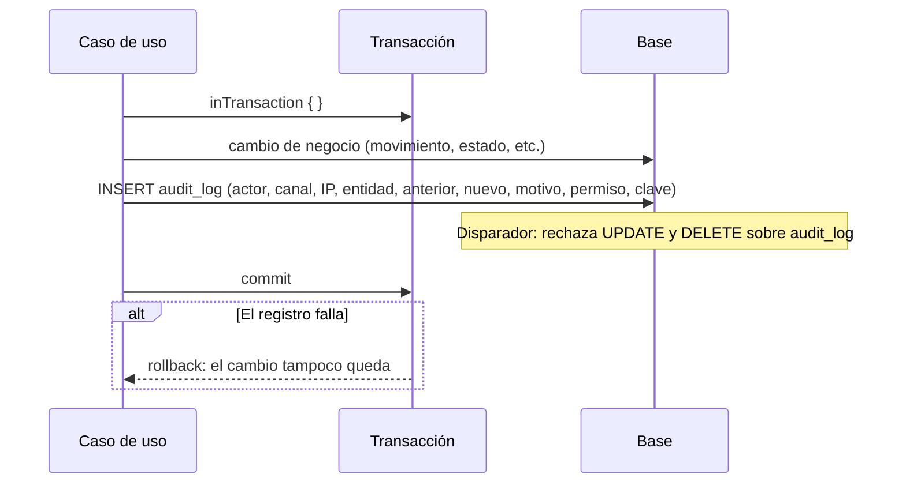

# Auditoría: bitácora de escrituras
> **Normativo.** Última revisión: 2026-10-09. Módulo: [M08](../modulos/M08-auditoria/README.md). Reglas detalladas en [seguridad/auditoria.md](../seguridad/auditoria.md).

## 1. Objetivo y actores

Responder quién hizo qué, cuándo, desde dónde y por qué, sobre **cualquier escritura** del sistema.
La bitácora no se edita ni se borra: si un registro está mal, se registra la corrección.

| Actor | Qué hace |
|---|---|
| Cualquier flujo | Escribe un registro junto con su cambio, en la misma transacción |
| Auditor (web) | Consulta la bitácora con filtros |

## 2. Precondiciones

- La tabla `audit_log` existe y tiene disparadores que impiden `UPDATE` y `DELETE`.
- Quien consulta tiene `audit.view`.

## 3. Flujo: registrar una escritura

El registro se escribe **dentro de la misma transacción** que el cambio. Si el cambio se confirma, el
registro existe; si el registro falla, el cambio no se confirma.

**Por qué en la misma transacción.** Un cambio sin registro es el caso que la bitácora existe para evitar:
el inventario cambió y nadie puede decir quién lo cambió. Por eso el fallo del registro revierte el cambio.

## 4. Qué debe llevar cada registro

| Campo | Ejemplo | Para qué |
|---|---|---|
| `actor_user_id` | 42 | Quién (o `null` si fue un sistema de servicio, con su clave) |
| `channel` | `WEB`, `APP`, `SERVICE` | Desde dónde |
| `source_ip` | dirección | Desde qué red |
| `entity_type`, `entity_id` | `product`, `1032` | Sobre qué |
| `previous_state`, `new_state` | total antes y después | Qué cambió |
| `reason`, `note` | `THEFT`, texto libre | Por qué |
| `permission_key` | `inventory.adjust_theft` | Con qué permiso se autorizó |
| `idempotency_key` | UUID | Qué operación original fue |
| `business_date` | fecha de negocio | Para cierres |

## 5. Pruebas de aceptación

**U1. Un cambio sin registro no se confirma**
- Dado un caso de uso con un registro de auditoría que falla a propósito.
- Cuando se ejecuta.
- Entonces el cambio de negocio tampoco queda escrito.

**U2. El registro no se edita**
- Dado un registro existente.
- Cuando cualquier proceso intenta `UPDATE` o `DELETE` sobre `audit_log`.
- Entonces la base lo rechaza.

**U3. Un registro crítico lleva la traza de acceso**
- Dado un registro de nivel `CRITICAL` (por ejemplo, un ajuste por robo).
- Cuando se intenta guardar sin la traza de la decisión de acceso.
- Entonces la base lo rechaza.

**U4. Un error de negocio no deja registro**
- Dado una operación rechazada por regla de negocio (por ejemplo, `INSUFFICIENT_STOCK`).
- Cuando se ejecuta.
- Entonces no se escribe registro de cambio, aunque sí se registra el intento denegado si el permiso
  lo exige.

**U5. La consulta filtra y pagina**
- Dado una bitácora con 10 000 registros.
- Cuando se consulta por entidad y rango de fechas.
- Entonces devuelve solo la página pedida, con el total calculado con el mismo filtro.

## 6. Errores

| Código | HTTP | Cuándo |
|---|---|---|
| `AUDIT_WRITE_FAILED` | 500 | El registro no se pudo escribir; la operación se revierte |
| `FORBIDDEN` | 403 | Consulta sin `audit.view` |

## 7. Lo que cambia respecto al legacy

- El legacy marcaba como `RELEVANT` los ajustes que deberían ser `CRITICAL`, porque la base no
  aceptaba la traza de decisión (nota en `adjustmentEntry`, `application/inventory/InventoryUseCases.kt`
  del código anterior). En el diseño nuevo, `CRITICAL` exige la traza, y la traza se escribe.
- El legacy podía modificar el historial del kardex; ese defecto hacía que la bitácora no bastara para
  explicar el inventario ([análisis](../analisis/legacy-entradas-salidas-ajustes-traslados.md) C1).
