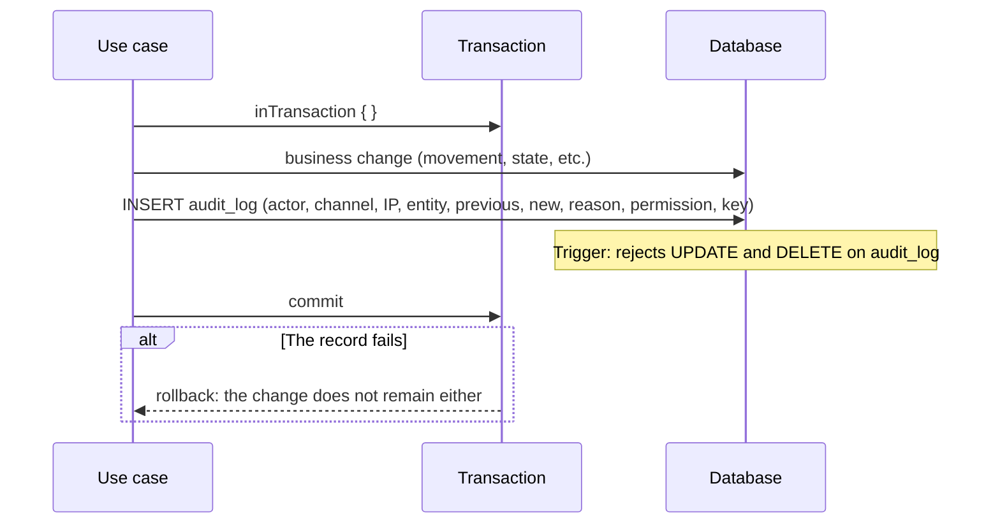

# Audit: write log
> **Normative.** Last revised: 2026-10-09. Module: [M08](../modulos/M08-auditoria/README.md). Detailed rules in [seguridad/auditoria.md](../seguridad/auditoria.md).

## 1. Objective and actors

Answer who did what, when, from where and why, for **any write** in the system.
The log is not edited or deleted: if a record is wrong, the correction is recorded.

| Actor | What it does |
|---|---|
| Any flow | Writes a record together with its change, in the same transaction |
| Auditor (web) | Queries the log with filters |

## 2. Preconditions

- The table `audit_log` exists and has triggers that prevent `UPDATE` and `DELETE`.
- Whoever queries has `audit.view`.

## 3. Flow: recording a write

The record is written **inside the same transaction** as the change. If the change commits, the
record exists; if the record fails, the change does not commit.

**Why in the same transaction.** A change without a record is the case the log exists to prevent:
the inventory changed and nobody can say who changed it. That is why a failure of the record reverts the change.

## 4. What each record must carry

| Field | Example | What for |
|---|---|---|
| `actor_user_id` | 42 | Who (or `null` if it was a service system, with its key) |
| `channel` | `WEB`, `APP`, `SERVICE` | From where |
| `source_ip` | address | From which network |
| `entity_type`, `entity_id` | `product`, `1032` | On what |
| `previous_state`, `new_state` | total before and after | What changed |
| `reason`, `note` | `THEFT`, free text | Why |
| `permission_key` | `inventory.adjust_theft` | With which permission it was authorized |
| `idempotency_key` | UUID | Which original operation it was |
| `business_date` | business date | For closings |

## 5. Acceptance tests

**U1. A change without a record is not committed**
- Given a use case with an audit record that fails on purpose.
- When it runs.
- Then the business change is not written either.

**U2. The record is not edited**
- Given an existing record.
- When any process attempts an `UPDATE` or `DELETE` on `audit_log`.
- Then the database rejects it.

**U3. A critical record carries the access trace**
- Given a record of level `CRITICAL` (for example, an adjustment for theft).
- When an attempt is made to save it without the trace of the access decision.
- Then the database rejects it.

**U4. A business error leaves no record**
- Given an operation rejected by a business rule (for example, `INSUFFICIENT_STOCK`).
- When it runs.
- Then no change record is written, although the denied attempt is recorded if the permission
  requires it.

**U5. The query filters and paginates**
- Given an audit log with 10,000 records.
- When it is queried by entity and date range.
- Then it returns only the requested page, with the total calculated with the same filter.

### 5-bis. Status of these tests (2026-10-10)

All five are green, and **U5 is the one that was missing**: the log was written on each
write since phase 3, but there was no way to read it.

- **U5** (the query filters and paginates): over real HTTP in
  `api/app/src/test/kotlin/dev/axzy/stock/app/AuditFlowTest.kt`, with the filter by entity
  and date range, the requested page and the **total calculated with the same filter**.
- **U1–U4** are tested where they belong: transactionality and immutability in the persistence
  module and in the domain, and immutability **also over HTTP** (an `UPDATE` on `audit_log`
  fails with "append-only", U2).

One thing the implementation fixed: **querying the log is recorded as access**
(`AUDIT_QUERIED`, level `ACCESS`), with the filters in the new state. Whoever looks at
the log is seeing who did what, and the module already said that: here it is done.

## 6. Errors

| Code | HTTP | When |
|---|---|---|
| `AUDIT_WRITE_FAILED` | 500 | The record could not be written; the operation is reverted |
| `FORBIDDEN` | 403 | Query without `audit.view` |

## 7. What changes with respect to the legacy

- The legacy marked as `RELEVANT` the adjustments that should be `CRITICAL`, because the database
  did not accept the decision trace (note in `adjustmentEntry`, `application/inventory/InventoryUseCases.kt`
  of the previous code). In the new design, `CRITICAL` requires the trace, and the trace is written.
- The legacy could modify the history of the ledger; that defect meant the log was not enough to
  explain the inventory ([analysis](../analisis/legacy-entradas-salidas-ajustes-traslados.md) C1).
