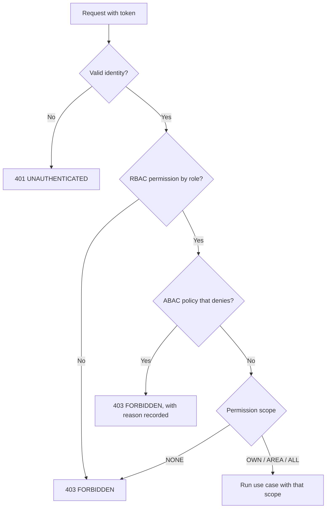

# Authentication and access decision
> **Normative.** Last revised: 2026-10-09. Origin rules: [ADR-0006](../adr/0006-rbac-mas-abac-denegar-por-defecto.md). Module: [M07](../modulos/M07-usuarios-accesos/README.md).

## 1. Objective and actors

Know who enters, with which credential, and decide whether they can do what they request. It is the gate to all
the other flows.

| Actor | What it does |
|---|---|
| User (app or web) | Signs in, renews the session, changes their password |
| Administrator | Assigns roles and scopes (see §6: user creation is outside phase 3) |
| Service system | Identifies itself with a service key, not with a user (see [etiquetas.md](etiquetas.md)) |

## 2. Preconditions

- The user exists, is active and has at least one role.
- For the first startup, the variable `ADMIN_BOOTSTRAP_PASSWORD` exists; the administrator must
  change it at their first sign-in.

## 3. Flow: sign-in and renewal

```mermaid
sequenceDiagram
    participant U as User
    participant API
    participant Auth as Login use case
    participant DB as Database

    U->>API: POST /v1/auth/login (user, password)
    API->>Auth: Login(user, password)
    Auth->>DB: Look up user
    Auth->>DB: Credential failures for that NAME in the last 15 min
    alt Five or more (whether or not the account exists)
        Auth-->>API: ACCOUNT_LOCKED (the password is not checked)
    else Does not exist, or the password does not match
        Note over Auth: With no account, it is checked against a decoy hash:<br/>the response takes the same time
        Auth->>DB: login_attempts (credential failure)
        Auth-->>API: INVALID_CREDENTIALS (same body in both cases)
    else Correct password, account disabled
        Auth-->>API: ACCOUNT_DISABLED
    else Correct
        Auth->>DB: BEGIN · last access · login_attempts (success) · refresh token (hash) · COMMIT
        Auth-->>API: access token (15 min) + refresh token (rotatable)
    end
    API-->>U: 200 / 401

    Note over U,API: When the access token expires
    U->>API: POST /v1/auth/refresh (refresh token)
    API->>Auth: Refresh(token)
    Auth->>DB: Look up by hash
    alt Token already used (reuse)
        Auth->>DB: revoke the WHOLE session family
        Auth-->>API: TOKEN_REUSED
    else Valid
        Auth->>DB: mark the previous one as used; issue a new one
        Auth-->>API: new pair of tokens
    end
```

**It cannot be found out whether a user exists.** A nonexistent user and a wrong password answer
the same and take the same time; the lock applies by name, whether or not the account exists; and "account
disabled" is only told to whoever guessed the password. Detail in
[api/autenticacion.md](../api/autenticacion.md).

**The access token only identifies.** It carries no roles or permissions: they are read from the database on each
request. It carries a credentials stamp, and if the password changes the token stops working on the
next request.

## 4. Session states

| State | How it is reached | What it allows |
|---|---|---|
| `ACTIVE` | Correct login or valid refresh | Everything the permissions grant |
| `ROTATED` | A new refresh was issued from this one | Nothing: its reuse revokes the family |
| `REVOKED` | Logout, password change, reuse, or revocation by an administrator | Nothing |
| `EXPIRED` | The lifetime passed | Nothing |

**Password change.** It revokes **all** the user's sessions, including the current one, in the same
transaction as the change. If the account has `must_change_password`, any route other than changing
the password, seeing who I am or signing out answers `PASSWORD_CHANGE_REQUIRED`.

## 5. Access decision

Every request that reaches a use case goes through the same decision, in this order:



Rules, from [ADR-0006](../adr/0006-rbac-mas-abac-denegar-por-defecto.md):

1. **Deny by default.** Without an explicit decision, it is denied.
2. **`DENY` beats `ALLOW`**, always.
3. **Scope as a ladder**: `NONE < OWN < AREA < ALL`. Having `AREA` does not grant `ALL`. If there are several
   roles, the greatest scope per permission is taken.
4. **ABAC raises the bar, it does not lower it.** A policy can deny something the role allows; it never grants
   something the role does not allow.
5. **Each use case decides**, with the `Actor` it receives. The controller does not decide permissions.

## 6. Scope of this flow in the first delivery

| Inside | Outside (later phase or pending decision) |
|---|---|
| Login, refresh with rotation, logout, password change | Password recovery by email |
| Lock after failed attempts | Creating and editing users from the web |
| Reading users, roles and permissions | Assigning roles from the web (there are no routes today) |
| Warehouse scopes (`user_warehouse_scopes`) | ABAC policy interface |

## 7. Acceptance tests

Implemented in `api/app/src/test/kotlin/dev/axzy/stock/app/AuthFlowTest.kt`, over real HTTP against
PostgreSQL. I6 and I7 are access engine rules and are covered by `AccessEngineTest` in `stock-domain`.
**I5 and I8 are pending**: they need a route protected by a permission, which arrives with the catalog (phase 4).

**I1. Wrong credentials reveal nothing**
- Given a user that does not exist and another existing one with a wrong password.
- When sign-in is attempted with both.
- Then both responses are identical (`INVALID_CREDENTIALS`).

**I2. Lock after failed attempts**
- Given a user and the attempt limit.
- When the limit is exceeded with a wrong password and then the correct one is used.
- Then it answers `ACCOUNT_LOCKED` for 15 minutes, and after that time it signs in. A name that
  does not exist is locked the same way, and insisting during the lock does not extend it.

**I3. Reusing a refresh revokes the family**
- Given a refresh already rotated.
- When it is used again.
- Then it answers `TOKEN_REUSED`, and the most recent valid refresh also stops working.

**I4. Changing the password revokes the sessions**
- Given two open sessions of the same user.
- When the password is changed from one.
- Then both sessions, including the one that made the change, answer 401 on their next request,
  without time having to pass.

**I5. Deny by default**
- Given a new endpoint with no permission associated in the catalog.
- When a user with any role calls it.
- Then it answers 403. An endpoint with no declared permission does not compile or start (verified in the architecture test).

**I6. DENY beats ALLOW**
- Given a user with a role that grants `inventory.move` and an exception that denies it.
- When they try to move.
- Then it answers 403.

**I7. The scope is the greatest of the roles, without raising it**
- Given a user with a role of scope `OWN` and another of `AREA` for the same permission.
- When they query.
- Then they have `AREA`, and not `ALL`.

**I8. A user who must change their password does not use the rest**
- Given a user with `must_change_password`.
- When they call any route other than changing the password and logout.
- Then it answers `PASSWORD_CHANGE_REQUIRED`.

## 8. Errors

The complete catalog, with its exact situation, is in [api/errores.md](../api/errores.md).

| Code | HTTP | When |
|---|---|---|
| `FIELD_REQUIRED` | 400 | The user or the password is missing |
| `INVALID_CREDENTIALS` | 401 | Wrong user or password; unknown, revoked or expired refresh token |
| `ACCOUNT_LOCKED` | 401 | Five credential failures with that name in 15 minutes |
| `ACCOUNT_DISABLED` | 401 | Account deactivated (on login, only with the correct password) |
| `TOKEN_REUSED` | 401 | Refresh reused; family revoked |
| `UNAUTHENTICATED` | 401 | No token, invalid or expired token, or the password changed |
| `PASSWORD_CHANGE_REQUIRED` | 403 | The account must change its password |
| `PERMISSION_DENIED` | 403 | Does not have the permission |
| `SCOPE_INSUFFICIENT` | 403 | Has the permission, but its scope does not cover that resource |
| `POLICY_DENIED`, `POLICY_REQUIRED` | 403 | A policy forbids it, or one that allows it is needed |
| `SEGREGATION_OF_DUTIES` | 403 | Cannot approve what they themselves captured |
| `WEAK_PASSWORD` | 422 | The new password does not meet the policy |
| `SAME_PASSWORD` | 422 | The new password is the same as the current one |

The authorization codes are different on purpose: for each one the user does something different.

## 9. Catalog permissions

The permission catalog lives in code (`PermissionCatalog`) and is seeded from there, not from a
migration (rule R5 of module M07). Each permission has `module.resource.action` and a set of
valid scopes. `NONE` is not a scope that can be granted.

## 10. Audit log

| Fact | Where it is kept | Why there |
|---|---|---|
| Each sign-in attempt, successful or not | `login_attempts` | It is written far more than the audit log, and an attacker must not be able to flood a book that is written in series |
| Reuse of a refresh token | `audit_log`, action `TOKEN_REUSE_DETECTED` | It is a signal of session compromise |
| Password change | `audit_log`, action `PASSWORD_CHANGED` | With how many sessions were closed |
| Each access denial | `audit_log`, action `ACCESS_DENIED`, in its own transaction | It has to remain even if the use case rolls back |

See [auditoria.md](auditoria.md).
