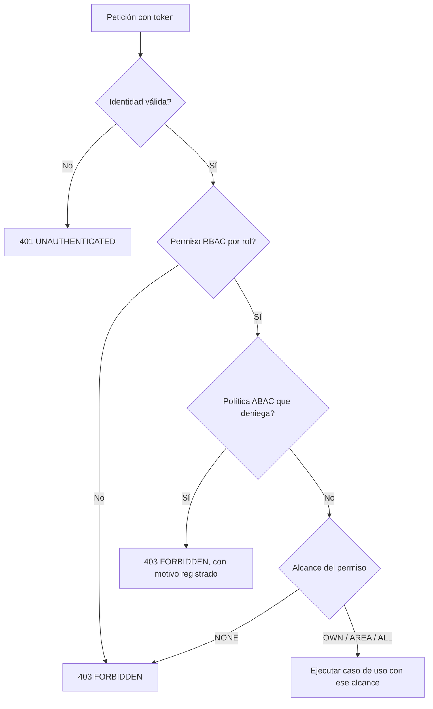

# Autenticación y decisión de acceso
> **Normativo.** Última revisión: 2026-10-09. Reglas de origen: [ADR-0006](../adr/0006-rbac-mas-abac-denegar-por-defecto.md). Módulo: [M07](../modulos/M07-usuarios-accesos/README.md).

## 1. Objetivo y actores

Saber quién entra, con qué credencial, y decidir si puede hacer lo que pide. Es la puerta de todos
los demás flujos.

| Actor | Qué hace |
|---|---|
| Usuario (app o web) | Inicia sesión, renueva sesión, cambia su contraseña |
| Administrador | Asigna roles y alcances (ver §6: el alta de usuarios queda fuera de la fase 3) |
| Sistema de servicio | Se identifica con clave de servicio, no con usuario (ver [etiquetas.md](etiquetas.md)) |

## 2. Precondiciones

- El usuario existe, está activo y tiene al menos un rol.
- Para el primer arranque, la variable `ADMIN_BOOTSTRAP_PASSWORD` existe; el administrador debe
  cambiarla en su primer inicio de sesión.

## 3. Flujo: inicio de sesión y renovación

```mermaid
sequenceDiagram
    participant U as Usuario
    participant API
    participant Auth as Caso de uso Login
    participant DB as Base

    U->>API: POST /v1/auth/login (usuario, contraseña)
    API->>Auth: Login(usuario, contraseña)
    Auth->>DB: Buscar usuario
    Auth->>DB: Fallos de credenciales de ese NOMBRE en los últimos 15 min
    alt Cinco o más (exista o no la cuenta)
        Auth-->>API: ACCOUNT_LOCKED (no se verifica la contraseña)
    else No existe, o la contraseña no coincide
        Note over Auth: Sin cuenta se verifica contra un hash señuelo:<br/>la respuesta tarda lo mismo
        Auth->>DB: login_attempts (fallo de credenciales)
        Auth-->>API: INVALID_CREDENTIALS (mismo cuerpo en ambos casos)
    else Contraseña correcta, cuenta desactivada
        Auth-->>API: ACCOUNT_DISABLED
    else Correcta
        Auth->>DB: BEGIN · último acceso · login_attempts (acierto) · refresh token (hash) · COMMIT
        Auth-->>API: access token (15 min) + refresh token (rotable)
    end
    API-->>U: 200 / 401

    Note over U,API: Cuando el access token vence
    U->>API: POST /v1/auth/refresh (refresh token)
    API->>Auth: Refresh(token)
    Auth->>DB: Buscar por hash
    alt Token ya usado (reutilización)
        Auth->>DB: revocar TODA la familia de sesiones
        Auth-->>API: TOKEN_REUSED
    else Válido
        Auth->>DB: marcar el anterior como usado; emitir uno nuevo
        Auth-->>API: nuevo par de tokens
    end
```

**No se puede averiguar si un usuario existe.** Usuario inexistente y contraseña incorrecta responden
lo mismo y tardan lo mismo; el bloqueo se aplica por nombre, exista o no la cuenta; y «cuenta
desactivada» solo se dice a quien acertó la contraseña. Detalle en
[api/autenticacion.md](../api/autenticacion.md).

**El token de acceso solo identifica.** No lleva roles ni permisos: se leen de la base en cada
petición. Lleva un sello de credenciales, y si la contraseña cambia el token deja de servir en la
petición siguiente.

## 4. Estados de la sesión

| Estado | Cómo se llega | Qué permite |
|---|---|---|
| `ACTIVE` | Login correcto o refresh válido | Todo lo que los permisos concedan |
| `ROTATED` | Se emitió un refresh nuevo a partir de este | Nada: su reutilización revoca la familia |
| `REVOKED` | Logout, cambio de contraseña, reutilización, o revocación por un administrador | Nada |
| `EXPIRED` | Pasó el tiempo de vida | Nada |

**Cambio de contraseña.** Revoca **todas** las sesiones del usuario, incluida la actual, en la misma
transacción que el cambio. Si la cuenta tiene `must_change_password`, cualquier ruta que no sea cambiar
la contraseña, ver quién soy o cerrar sesión responde `PASSWORD_CHANGE_REQUIRED`.

## 5. Decisión de acceso

Toda petición que llega a un caso de uso pasa por la misma decisión, en este orden:



Reglas, de las [ADR-0006](../adr/0006-rbac-mas-abac-denegar-por-defecto.md):

1. **Denegar por defecto.** Sin decisión explícita, se niega.
2. **`DENY` gana a `ALLOW`**, siempre.
3. **Alcance en escalera**: `NONE < OWN < AREA < ALL`. Tener `AREA` no concede `ALL`. Si hay varios
   roles, se toma el mayor alcance por permiso.
4. **ABAC sube el listón, no lo baja.** Una política puede denegar algo que el rol permite; nunca
   concede algo que el rol no permite.
5. **Cada caso de uso decide**, con el `Actor` que recibe. El controlador no decide permisos.

## 6. Alcance de este flujo en la primera entrega

| Dentro | Fuera (fase posterior o pendiente de decisión) |
|---|---|
| Login, refresh con rotación, logout, cambio de contraseña | Recuperación de contraseña por correo |
| Bloqueo por intentos fallidos | Alta y edición de usuarios desde la web |
| Lectura de usuarios, roles y permisos | Asignación de roles desde la web (hoy no hay rutas) |
| Alcances por bodega (`user_warehouse_scopes`) | Interfaz de políticas ABAC |

## 7. Pruebas de aceptación

Implementadas en `api/app/src/test/kotlin/dev/axzy/stock/app/AuthFlowTest.kt`, por HTTP real contra
PostgreSQL. I6 e I7 son reglas del motor de acceso y las cubre `AccessEngineTest` en `stock-domain`.
**I5 e I8 están pendientes**: necesitan una ruta protegida por permiso, que llega con el catálogo (fase 4).

**I1. Credenciales incorrectas no revelan nada**
- Dado un usuario que no existe y otro existente con contraseña errónea.
- Cuando se intenta entrar con ambos.
- Entonces las dos respuestas son idénticas (`INVALID_CREDENTIALS`).

**I2. Bloqueo tras intentos fallidos**
- Dado un usuario y el límite de intentos.
- Cuando se supera el límite con contraseña errónea y luego se usa la correcta.
- Entonces responde `ACCOUNT_LOCKED` durante 15 minutos, y después de ese tiempo entra. Un nombre que
  no existe se bloquea igual, e insistir durante el bloqueo no lo prolonga.

**I3. Reutilizar un refresh revoca la familia**
- Dado un refresh ya rotado.
- Cuando se usa de nuevo.
- Entonces responde `TOKEN_REUSED`, y el refresh válido más reciente también deja de servir.

**I4. Cambiar la contraseña revoca las sesiones**
- Dado dos sesiones abiertas del mismo usuario.
- Cuando se cambia la contraseña desde una.
- Entonces las dos sesiones, incluida la que hizo el cambio, responden 401 en su siguiente petición,
  sin que pase el tiempo.

**I5. Denegar por defecto**
- Dado un endpoint nuevo sin permiso asociado en el catálogo.
- Cuando un usuario con cualquier rol lo llama.
- Entonces responde 403. Un endpoint sin permiso declarado no compila o no arranca (verificado en la prueba de arquitectura).

**I6. DENY gana a ALLOW**
- Dado un usuario con un rol que concede `inventory.move` y una excepción que lo deniega.
- Cuando intenta mover.
- Entonces responde 403.

**I7. El alcance es el mayor de los roles, sin subirlo**
- Dado un usuario con un rol de alcance `OWN` y otro de `AREA` para el mismo permiso.
- Cuando consulta.
- Entonces tiene `AREA`, y no `ALL`.

**I8. Un usuario que debe cambiar contraseña no usa el resto**
- Dado un usuario con `must_change_password`.
- Cuando llama a cualquier ruta distinta de cambio de contraseña y de logout.
- Entonces responde `PASSWORD_CHANGE_REQUIRED`.

## 8. Errores

El catálogo completo, con su situación exacta, está en [api/errores.md](../api/errores.md).

| Código | HTTP | Cuándo |
|---|---|---|
| `FIELD_REQUIRED` | 400 | Falta el usuario o la contraseña |
| `INVALID_CREDENTIALS` | 401 | Usuario o contraseña incorrectos; refresh token desconocido, revocado o vencido |
| `ACCOUNT_LOCKED` | 401 | Cinco fallos de credenciales con ese nombre en 15 minutos |
| `ACCOUNT_DISABLED` | 401 | Cuenta desactivada (en el login, solo con la contraseña correcta) |
| `TOKEN_REUSED` | 401 | Refresh reutilizado; familia revocada |
| `UNAUTHENTICATED` | 401 | Sin token, token inválido o caducado, o la contraseña cambió |
| `PASSWORD_CHANGE_REQUIRED` | 403 | La cuenta debe cambiar su contraseña |
| `PERMISSION_DENIED` | 403 | No tiene el permiso |
| `SCOPE_INSUFFICIENT` | 403 | Tiene el permiso, pero su alcance no cubre ese recurso |
| `POLICY_DENIED`, `POLICY_REQUIRED` | 403 | Una política lo prohíbe, o hace falta una que lo permita |
| `SEGREGATION_OF_DUTIES` | 403 | No puede aprobar lo que él mismo capturó |
| `WEAK_PASSWORD` | 422 | La contraseña nueva no cumple la política |
| `SAME_PASSWORD` | 422 | La contraseña nueva es igual a la actual |

Los códigos de autorización son distintos a propósito: ante cada uno el usuario hace algo diferente.

## 9. Permisos del catálogo

El catálogo de permisos vive en código (`PermissionCatalog`) y se siembra desde ahí, no desde una
migración (regla R5 del módulo M07). Cada permiso tiene `módulo.recurso.acción` y un conjunto de
alcances válidos. `NONE` no es un alcance que se pueda conceder.

## 10. Bitácora

| Hecho | Dónde queda | Por qué ahí |
|---|---|---|
| Cada intento de login, acertado o no | `login_attempts` | Se escribe mucho más que la bitácora, y un atacante no debe poder inundar un libro que se escribe en serie |
| Reuso de un refresh token | `audit_log`, acción `TOKEN_REUSE_DETECTED` | Es una señal de compromiso de la sesión |
| Cambio de contraseña | `audit_log`, acción `PASSWORD_CHANGED` | Con cuántas sesiones se cerraron |
| Cada denegación de acceso | `audit_log`, acción `ACCESS_DENIED`, en una transacción propia | Tiene que quedar aunque el caso de uso revierta |

Ver [auditoria.md](auditoria.md).
