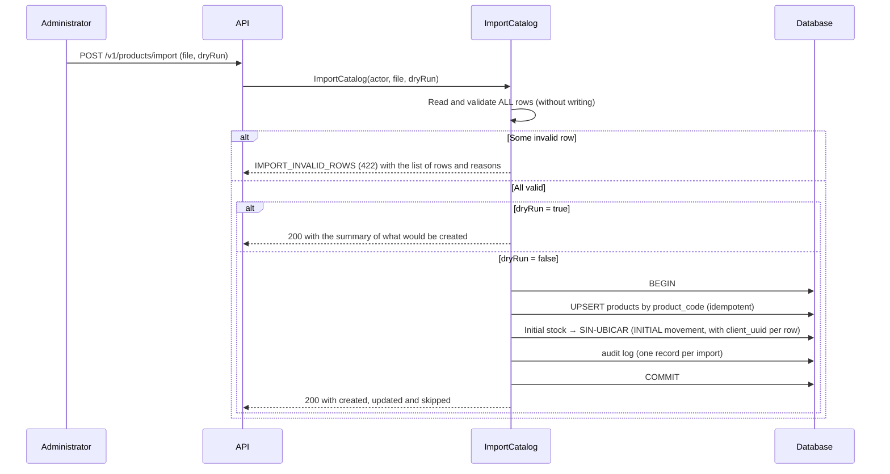

# Catalog: products, locations, warehouses and import
> **Normative.** Last revised: 2026-10-10 (K1–K6 green; see §5-bis). Origin rules: [ADR-0011](../adr/0011-catalogo-fuente-maestra.md), [ADR-0009](../adr/0009-ubicacion-de-recepcion-real.md), [ADR-0012](../adr/0012-conciliar-stock-heredado-con-conteo.md). Module: [M01](../modulos/M01-catalogo/README.md).

## 1. Objective and actors

Maintain the master list of products, warehouses and locations on which all the other flows operate.
The API is the master source; there is no periodic synchronization with other systems (ADR-0011).

| Actor | What it does |
|---|---|
| Administrator (web) | Creates and edits products, warehouses and locations; imports the initial file |
| Operator (app) | Queries products and locations; does not modify them |

## 2. Preconditions

- At least one warehouse is marked as default (unique index: only one).
- The special locations (`RECEIVING` and `UNASSIGNED`) exist; the initial migration creates them.

## 3. Data rules

| Rule | Why |
|---|---|
| The product code is unique and **is not changed** | It is the key used by stock, orders and the ERP |
| A location code is written in uppercase (hall, code and position) | Avoids two locations that differ only in case |
| The receiving location cannot be deactivated | All received goods go through it ([ADR-0009](../adr/0009-ubicacion-de-recepcion-real.md)) |
| Inactive products do not receive new movements, but keep their history | The ledger is not rewritten |
| Two codes `X` and `XN` are two different products | Business decision with an accepted risk ([ADR-0011](../adr/0011-catalogo-fuente-maestra.md)) |

## 4. Flow: import the initial file

The import is **strict**: an invalid row rejects the entire file. Nothing is corrected by guessing
(ADR-0011). It is run once at the cutover, and afterwards the catalog is maintained through the API.

**Why the initial stock goes to `SIN-UBICAR`.** The file carries 10,914,130 units without a breakdown by
shelf. Loading them into a location would misstate the inventory from day one. They are reconciled with a count before
the cutover ([ADR-0012](../adr/0012-conciliar-stock-heredado-con-conteo.md)).

**Why it is idempotent.** In the legacy, a second import of the same file would re-insert
what already existed (M3 in the [analysis](../analisis/legacy-entradas-salidas-ajustes-traslados.md)). Here the key
is the product code and the `client_uuid` of each movement is derived from the row: importing twice
duplicates nothing.

## 5. Acceptance tests

**K1. An invalid row rejects the entire file**
- Given a file with 1,398 valid rows and one with an empty code.
- When it is imported.
- Then it answers `IMPORT_INVALID_ROWS` with that row, and no product is created.

**K2. The import is idempotent**
- Given a valid file already imported.
- When it is imported again.
- Then there are no duplicate products, the initial stock is not added again and the summary indicates `0` created.

**K3. The product code is not changed**
- Given an existing product.
- When an attempt is made to change its code.
- Then it answers `PRODUCT_CODE_IMMUTABLE` (422).

**K4. The receiving location is not deactivated**
- Given an attempt to deactivate the `RECEIVING` location.
- Then it answers `RECEIVING_LOCATION_PROTECTED` (409).

**K5. An inactive product does not receive movements**
- Given an inactive product.
- When a stock movement is attempted.
- Then it answers `PRODUCT_NOT_FOUND` (the active product is the one that is looked up).

**K6. Only one default warehouse**
- Given that a default warehouse exists.
- When another one is marked as default.
- Then the previous one stops being default in the same transaction, or the operation is rejected. Two are never left.

### 5-bis. Status of these tests (2026-10-10)

The six are automated and green in `api/app/src/test/kotlin/dev/axzy/stock/app/CatalogFlowTest.kt`,
over real HTTP. Two nuances that the document did not state and are worth writing down:

- **K1 answers `422 IMPORT_INVALID_ROWS` with any `dryRun`.** Validation happens before
  looking at the simulation: a file with bad rows does not produce a valid report in either
  mode. `IMPORT_HAS_REJECTIONS` is declared in the error catalog and **is not emitted**.
- **K5, the "does not receive movements" part, is closed in phase 5.** Today the movements endpoint
  does not exist yet; what is checked is what the document itself says it must answer: the inactive product
  stops being found (`PRODUCT_NOT_FOUND`). When the engine arrives, the test is extended to the
  movement.

And a declared gap: the import accepts **CSV and TSV**; native **XLSX** arrives with the data migration
(M10). Until then it answers `IMPORT_FILE_FORMAT` saying so, instead of failing in a way that looks like a user error.

## 6. Errors

| Code | HTTP | When |
|---|---|---|
| `PRODUCT_NOT_FOUND` | 404 | The product does not exist or is inactive |
| `PRODUCT_CODE_IMMUTABLE` | 422 | An attempt is made to change a product's code |
| `PRODUCT_CODE_DUPLICATE` | 409 | The code already exists |
| `LOCATION_NOT_FOUND` | 404 | The location does not exist or is inactive |
| `RECEIVING_LOCATION_PROTECTED` | 409 | An attempt is made to deactivate the receiving location |
| `IMPORT_INVALID_ROWS` | 422 | The file has invalid rows; `details` lists the rows (up to 50) with their reason |

## 7. Permissions

| Action | Permission |
|---|---|
| View products | `product.view` |
| Create, edit, delete | `product.create`, `product.edit`, `product.delete` |
| Import | `product.import` |
| View and edit locations | `location.view`, `location.edit` |
| Create and delete locations | `location.create`, `location.delete` |
| Warehouses | `warehouse.view`, `warehouse.create`, `warehouse.edit` |

## 8. Audit log

Each creation, edit and deactivation writes to `audit_log`. An import writes one record per
file, with the summary, and not one per row.
