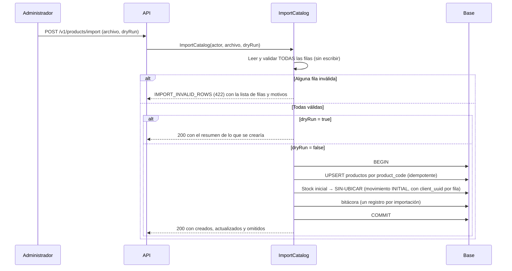

# Catálogo: productos, ubicaciones, bodegas e importación
> **Normativo.** Última revisión: 2026-10-09. Reglas de origen: [ADR-0011](../adr/0011-catalogo-fuente-maestra.md), [ADR-0009](../adr/0009-ubicacion-de-recepcion-real.md), [ADR-0012](../adr/0012-conciliar-stock-heredado-con-conteo.md). Módulo: [M01](../modulos/M01-catalogo/README.md).

## 1. Objetivo y actores

Tener la lista maestra de productos, bodegas y ubicaciones sobre la que operan todos los demás flujos.
La API es la fuente maestra; no hay sincronización periódica con otros sistemas (ADR-0011).

| Actor | Qué hace |
|---|---|
| Administrador (web) | Crea y edita productos, bodegas y ubicaciones; importa el archivo inicial |
| Operador (app) | Consulta productos y ubicaciones; no los modifica |

## 2. Precondiciones

- Hay al menos una bodega marcada como predeterminada (índice único: solo una).
- Las ubicaciones especiales (`RECEIVING` y `UNASSIGNED`) existen; las crea la migración inicial.

## 3. Reglas de datos

| Regla | Por qué |
|---|---|
| El código de producto es único y **no se cambia** | Es la clave que usan las existencias, las órdenes y el ERP |
| Un código de ubicación se escribe en mayúsculas (hall, código y posición) | Evita dos ubicaciones que solo difieren en mayúsculas |
| La ubicación de recepción no se puede desactivar | Toda mercancía recibida pasa por ella ([ADR-0009](../adr/0009-ubicacion-de-recepcion-real.md)) |
| Los productos inactivos no reciben movimientos nuevos, pero conservan su historial | El kardex no se reescribe |
| Dos códigos `X` y `XN` son dos productos distintos | Decisión de negocio con riesgo aceptado ([ADR-0011](../adr/0011-catalogo-fuente-maestra.md)) |

## 4. Flujo: importar el archivo inicial

La importación es **estricta**: una fila inválida rechaza el archivo entero. No se corrige nada
adivinando (ADR-0011). Se ejecuta una sola vez en el corte, y después el catálogo se mantiene desde la API.

**Por qué el stock inicial va a `SIN-UBICAR`.** El archivo trae 10.914.130 unidades sin desglose por
estante. Cargarlas a una ubicación inventaría mal desde el primer día. Se concilian con conteo antes
del corte ([ADR-0012](../adr/0012-conciliar-stock-heredado-con-conteo.md)).

**Por qué es idempotente.** En el legacy, una segunda importación del mismo archivo volvía a insertar lo
que ya existía (M3 en el [análisis](../analisis/legacy-entradas-salidas-ajustes-traslados.md)). Aquí la clave
es el código de producto y el `client_uuid` de cada movimiento se deriva de la fila: importar dos veces no
duplica nada.

## 5. Pruebas de aceptación

**K1. Una fila inválida rechaza el archivo entero**
- Dado un archivo con 1.398 filas válidas y una con un código vacío.
- Cuando se importa.
- Entonces responde `IMPORT_INVALID_ROWS` con esa fila, y no se crea ningún producto.

**K2. La importación es idempotente**
- Dado un archivo válido ya importado.
- Cuando se importa de nuevo.
- Entonces no hay productos duplicados, el stock inicial no se suma otra vez y el resumen indica `0` creados.

**K3. El código de producto no se cambia**
- Dado un producto existente.
- Cuando se intenta cambiar su código.
- Entonces responde `PRODUCT_CODE_IMMUTABLE` (422).

**K4. La recepción no se desactiva**
- Dado que se intenta desactivar la ubicación `RECEIVING`.
- Entonces responde `RECEIVING_LOCATION_PROTECTED` (409).

**K5. Un producto inactivo no recibe movimientos**
- Dado un producto inactivo.
- Cuando se intenta un movimiento de existencias.
- Entonces responde `PRODUCT_NOT_FOUND` (el producto activo es el que se busca).

**K6. Solo una bodega predeterminada**
- Dado que existe una bodega predeterminada.
- Cuando se marca otra como predeterminada.
- Entonces la anterior deja de serlo en la misma transacción, o la operación se rechaza. Nunca quedan dos.

## 6. Errores

| Código | HTTP | Cuándo |
|---|---|---|
| `PRODUCT_NOT_FOUND` | 404 | El producto no existe o está inactivo |
| `PRODUCT_CODE_IMMUTABLE` | 422 | Se intenta cambiar el código de un producto |
| `PRODUCT_CODE_DUPLICATE` | 409 | El código ya existe |
| `LOCATION_NOT_FOUND` | 404 | La ubicación no existe o está inactiva |
| `RECEIVING_LOCATION_PROTECTED` | 409 | Se intenta desactivar la ubicación de recepción |
| `IMPORT_INVALID_ROWS` | 422 | El archivo tiene filas inválidas; lista cada una con su motivo |

## 7. Permisos

| Acción | Permiso |
|---|---|
| Ver productos | `product.view` |
| Crear, editar, eliminar | `product.create`, `product.edit`, `product.delete` |
| Importar | `product.import` |
| Ver y editar ubicaciones | `location.view`, `location.edit` |
| Crear y eliminar ubicaciones | `location.create`, `location.delete` |
| Bodegas | `warehouse.view`, `warehouse.create`, `warehouse.edit` |

## 8. Bitácora

Cada alta, edición y desactivación escribe en `audit_log`. Una importación escribe un registro por
archivo, con el resumen, y no uno por fila.
