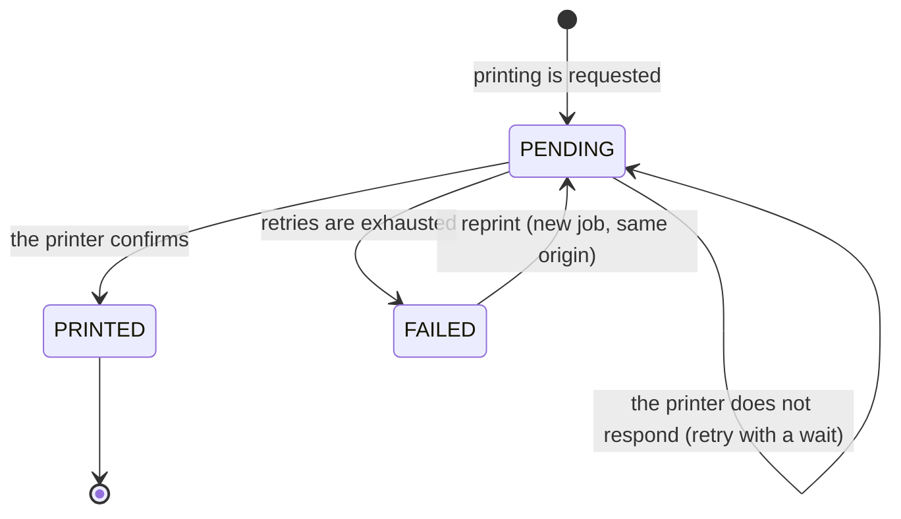
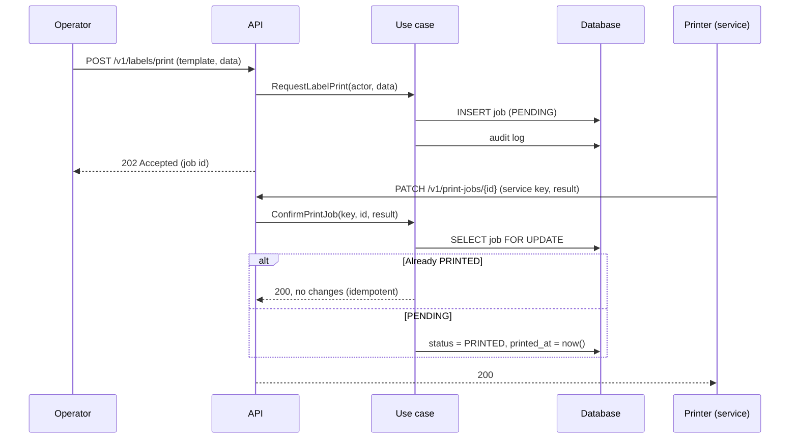

# Labels: templates, print queue and reprint
> **Normative.** Last revised: 2026-10-09. Origin rules: [ADR-0010](../adr/0010-rutas-de-servicio-con-api-key.md). Module: [M06](../modulos/M06-etiquetas/README.md).

## 1. Objective and actors

Print product and location labels, know which ones were really printed, and reprint.

| Actor | What it does |
|---|---|
| Operator (app) | Requests printing a product or location label; scans labels |
| Administrator (web) | Edits templates; queries the print history |
| Printer (service system) | Confirms each print with a service key, not with a user |

## 2. Preconditions

- The template exists and is active.
- The printer is registered with its service key.

## 3. Print job states

A label is **not** printed until the printer confirms it. A request that reaches the printer while it is off
stays `PENDING` and is retried; it is not marked as printed just because it was requested.

## 4. Flow: request, print and confirm

**Why `202` and not `200`.** Printing does not happen in that request: it is only enqueued. Answering `200`
would say the label already came out.

**Why the service key.** Confirmation is done by a machine, with no user session. That key
carries no user permissions and no warehouse scope; it can only confirm print jobs.

## 5. Acceptance tests

**L1. Requesting a label does not mark it as printed**
- Given an active template.
- When the operator requests printing.
- Then the job is `PENDING` and the response is 202.

**L2. The printer confirms once**
- Given a `PENDING` job.
- When the printer confirms it twice.
- Then it is `PRINTED` with a single `printed_at`; the second confirmation answers 200 without changes.

**L3. Printer off: the job waits and is not lost**
- Given a `PENDING` job and a printer that does not respond.
- When the retries pass.
- Then it remains `PENDING` or moves to `FAILED` according to the limit, and the operator can reprint it.

**L4. The service key is good for nothing else**
- Given a printer key.
- When it is used to create a product or a movement.
- Then it answers 403.

**L5. Reprinting creates a new job**
- Given a `PRINTED` job.
- When it is reprinted.
- Then there is a new `PENDING` job and the original does not change.

### 5-bis. Status of these tests (2026-10-10)

All five are green over real HTTP
(`api/app/src/test/kotlin/dev/axzy/stock/app/LabelFlowTest.kt`):

- **L1** (requesting a label does not mark it as printed): printing answers `202` and the
  job is `PENDING` with `attempts = 0` and `printedAt = null`.
- **L3** (printer off: the job waits and is not lost): the queue finds it by
  status, which is what makes `?status=` useful.
- **L5** (reprinting creates a new job): new id, `PENDING`, and
  `reprintedFromId` pointing to the original —the column that migration V14 added—.

- **L2** (the printer confirms once): the first confirmation moves the job to
  `PRINTED` with its time and **the second answers `LABEL_ALREADY_PRINTED` without touching it**.
- **L4** (the service key is good for nothing else): without a credential or with one that is not
  valid it answers `401 INVALID_SERVICE_KEY` and the job remains pending; the credential **does not
  authenticate a person** as an access token; and a client cannot declare itself a service channel
  with a header —the channel is set by the credential, and `X-Client-Channel:
  SERVICE_PRINTER` answers `400`—.

Both live in
`api/app/src/test/kotlin/dev/axzy/stock/app/PrintJobConfirmationTest.kt`, with the check that
the log stores `SERVICE_PRINTER` as the channel and the key's identifier: a job marked by a system
is distinguished from one done by a person.

## 6. Errors

| Code | HTTP | When |
|---|---|---|
| `TEMPLATE_NOT_FOUND` | 404 | The template does not exist or is inactive |
| `PRINT_JOB_NOT_FOUND` | 404 | The job does not exist |
| `SERVICE_KEY_INVALID` | 401 | The service key is not valid |
| `FORBIDDEN` | 403 | The service key attempts something outside the confirmation |

## 7. Permissions

| Action | Permission |
|---|---|
| Request printing and reprint | `label.print`, `label.reprint` |
| View templates | `label.template_view` |
| Edit templates | `label.template_edit` |
| View queue | `label.queue_view` |
| Manage queue | `label.queue_manage` |
| Manage printers | `print_device.manage` |
| Confirm printing | Service key, not a user permission |

## 8. Audit log

Requesting, confirming, reprinting and editing templates write to `audit_log`. The printer's confirmation
records the service key used, not a user.
