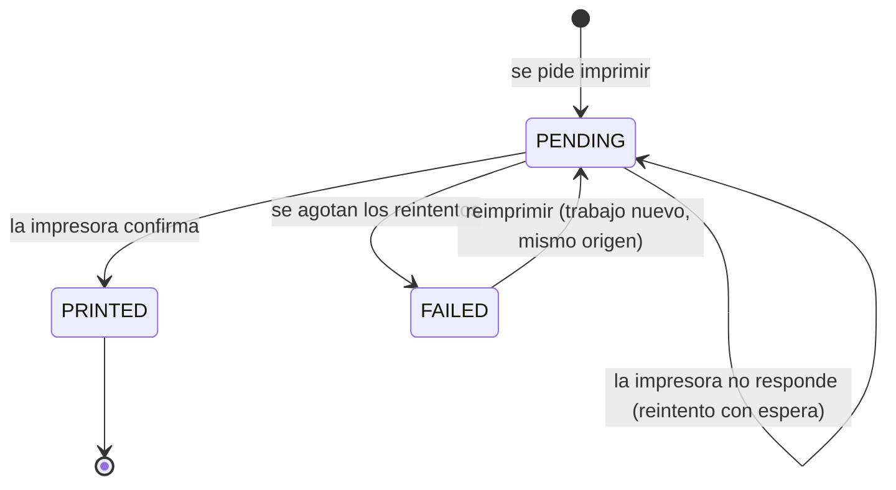
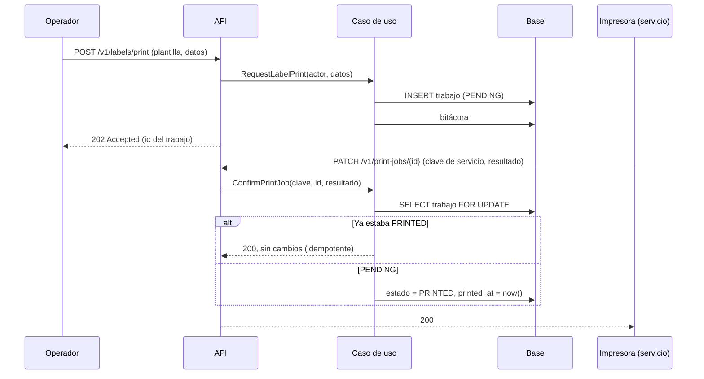

# Etiquetas: plantillas, cola de impresión y reimpresión
> **Normativo.** Última revisión: 2026-10-09. Reglas de origen: [ADR-0010](../adr/0010-rutas-de-servicio-con-api-key.md). Módulo: [M06](../modulos/M06-etiquetas/README.md).

## 1. Objetivo y actores

Imprimir etiquetas de malla y de ubicación, saber cuáles se imprimieron de verdad, y reimprimir.

| Actor | Qué hace |
|---|---|
| Operador (app) | Pide imprimir una etiqueta de producto o de ubicación; escanea etiquetas |
| Administrador (web) | Edita plantillas; consulta el historial de impresión |
| Impresora (sistema de servicio) | Confirma cada impresión con una clave de servicio, no con un usuario |

## 2. Precondiciones

- La plantilla existe y está activa.
- La impresora está registrada con su clave de servicio.

## 3. Estados del trabajo de impresión

Una etiqueta **no** está impresa hasta que la impresora lo confirma. Una petición que llega a la
impresora apagada queda `PENDING` y se reintenta; no se marca como impresa solo por haberse pedido.

## 4. Flujo: pedir, imprimir y confirmar

**Por qué `202` y no `200`.** La impresión no ocurre en esa petición: solo se encola. Responder `200`
diría que la etiqueta ya salió.

**Por qué la clave de servicio.** La confirmación la hace una máquina, sin sesión de usuario. Esa clave no
lleva permisos de usuario ni alcance de bodega; solo puede confirmar trabajos de impresión.

## 5. Pruebas de aceptación

**L1. Pedir una etiqueta no la marca como impresa**
- Dado una plantilla activa.
- Cuando el operador pide imprimir.
- Entonces el trabajo queda `PENDING` y la respuesta es 202.

**L2. La impresora confirma una vez**
- Dado un trabajo `PENDING`.
- Cuando la impresora lo confirma dos veces.
- Entonces queda `PRINTED` con una sola `printed_at`; la segunda confirmación responde 200 sin cambios.

**L3. Impresora apagada: el trabajo espera y no se pierde**
- Dado un trabajo `PENDING` y una impresora que no responde.
- Cuando pasan los reintentos.
- Entonces sigue `PENDING` o pasa a `FAILED` según el límite, y el operador puede reimprimirlo.

**L4. La clave de servicio no sirve para otra cosa**
- Dado una clave de impresora.
- Cuando se usa para crear un producto o un movimiento.
- Entonces responde 403.

**L5. Reimprimir crea un trabajo nuevo**
- Dado un trabajo `PRINTED`.
- Cuando se reimprime.
- Entonces hay un trabajo nuevo `PENDING` y el original no cambia.

### 5-bis. Estado de estas pruebas (2026-10-10)

Las cinco están en verde por HTTP real
(`api/app/src/test/kotlin/dev/axzy/stock/app/LabelFlowTest.kt`):

- **L1** (pedir una etiqueta no la marca como impresa): la impresión responde `202` y el
  trabajo queda `PENDING` con `attempts = 0` y `printedAt = null`.
- **L3** (impresora apagada: el trabajo espera y no se pierde): la cola lo encuentra por
  estado, que es lo que hace útil `?status=`.
- **L5** (reimprimir crea un trabajo nuevo): id nuevo, `PENDING`, y
  `reprintedFromId` apuntando al original —la columna que añadió la migración V14—.

- **L2** (la impresora confirma una vez): la primera confirmación pasa el trabajo a
  `PRINTED` con su hora y **la segunda responde `LABEL_ALREADY_PRINTED` sin tocarlo**.
- **L4** (la clave de servicio no sirve para otra cosa): sin credencial o con una que no
  vale responde `401 INVALID_SERVICE_KEY` y el trabajo sigue pendiente; la credencial **no
  autentica a una persona** como token de acceso; y un cliente no puede declararse canal
  de servicio con una cabecera —el canal lo fija la credencial, y `X-Client-Channel:
  SERVICE_PRINTER` responde `400`—.

Ambas viven en
`api/app/src/test/kotlin/dev/axzy/stock/app/PrintJobConfirmationTest.kt`, con la
comprobación de que la bitácora guarda `SERVICE_PRINTER` como canal y el identificador de
la clave: un trabajo marcado por un sistema se distingue de uno hecho por una persona.

## 6. Errores

| Código | HTTP | Cuándo |
|---|---|---|
| `TEMPLATE_NOT_FOUND` | 404 | La plantilla no existe o está inactiva |
| `PRINT_JOB_NOT_FOUND` | 404 | El trabajo no existe |
| `SERVICE_KEY_INVALID` | 401 | La clave de servicio no es válida |
| `FORBIDDEN` | 403 | La clave de servicio intenta algo fuera de la confirmación |

## 7. Permisos

| Acción | Permiso |
|---|---|
| Pedir impresión y reimprimir | `label.print`, `label.reprint` |
| Ver plantillas | `label.template_view` |
| Editar plantillas | `label.template_edit` |
| Ver cola | `label.queue_view` |
| Gestionar cola | `label.queue_manage` |
| Gestionar impresoras | `print_device.manage` |
| Confirmar impresión | Clave de servicio, no permiso de usuario |

## 8. Bitácora

Pedir, confirmar, reimprimir y editar plantillas escriben en `audit_log`. La confirmación de la impresora
registra la clave de servicio usada, no un usuario.
