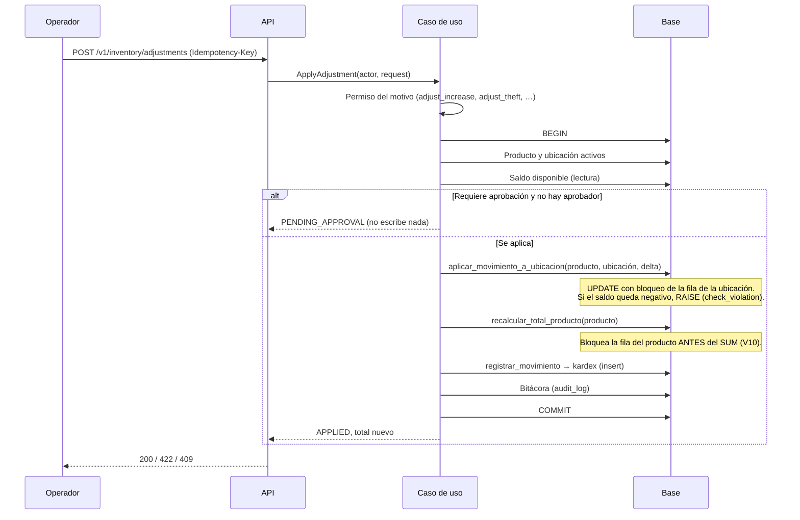
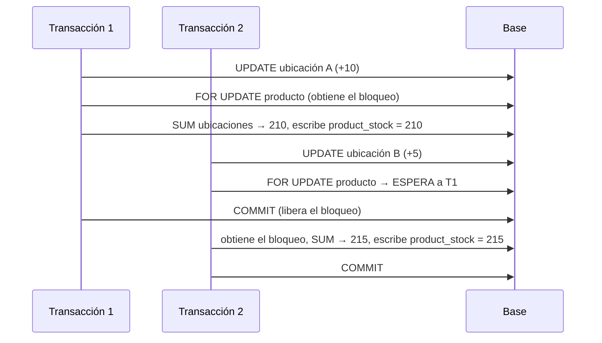

# Existencias y ajustes
> **Normativo.** Última revisión: 2026-10-10 (A1–A10 en verde; ver §7-bis). Reglas de origen: [ADR-0007](../adr/0007-multi-bodega-desde-el-esquema.md), [ADR-0008](../adr/0008-discrepancias-y-merma.md), [ADR-0009](../adr/0009-ubicacion-de-recepcion-real.md). Módulo: [M02](../modulos/M02-existencias/README.md).

## 1. Objetivo y actores

Saber cuánto hay de cada producto y en qué ubicación, y poder explicar cada cambio.

| Actor | Qué hace |
|---|---|
| Operador de piso (app) | Ubica mercancía recibida, mueve entre estantes, registra mermas con motivo |
| Supervisor (web) | Aprueba ajustes que lo requieren; consulta existencias y kardex |
| Sistemas (otros flujos) | Recepción, surtido y traslados llaman a este flujo; nadie escribe existencias por fuera |

## 2. Precondiciones

- El producto y la ubicación existen y están activos ([catalogo.md](catalogo.md)).
- La ubicación pertenece a una bodega.
- Quien llama tiene el permiso del tipo de movimiento ([autenticacion-y-permisos.md](autenticacion-y-permisos.md) §5).

## 3. Modelo de datos (resumen)

| Tabla | Qué guarda | Regla |
|---|---|---|
| `kardex` | Libro de movimientos | Solo se inserta. Nunca se edita ni se borra |
| `stock_by_location` | Existencias por ubicación | Proyección; `quantity >= 0` |
| `product_stock` | Total por producto | Proyección: suma de ubicaciones más tránsito no recibido |
| `stock_in_transit` | Mercancía en traslado | Ver [traslados.md](traslados.md) |

Todo cambio de existencias pasa por las funciones SQL del motor
([ADR-0015](../adr/0015-postgresql-flyway-motor-en-sql.md)): `aplicar_movimiento_a_ubicacion`,
`recalcular_total_producto` y `registrar_movimiento`. La API no escribe esas tablas directamente.

## 4. Flujo: aplicar un movimiento

Un movimiento puede ser un ajuste (aumento o merma), un ubicar (de recepción a estante) o un mover
(de un estante a otro). Los tres siguen el mismo camino dentro del motor.

**Por qué el orden importa.** Primero se decide (permiso, aprobación, saldo), luego se escribe.
Un movimiento que espera aprobación **no toca** el inventario: un cambio de stock sin autorizar es
justo lo que la aprobación evita.

## 5. Concurrencia: el total por producto (Q1)

Dos movimientos del mismo producto en ubicaciones distintas pueden correr a la vez. Sin bloqueo del
producto, el segundo recálculo no ve el cambio del primero y escribe un total que lo ignora.

Sin el `FOR UPDATE` de la línea 3, T2 escribiría 205. Esa era la pérdida reproducida.

## 6. Estados

El movimiento no tiene estados: se inserta o no se inserta. Un ajuste tiene dos resultados:

| Resultado | Cuándo | Qué se escribe |
|---|---|---|
| `APPLIED` | El permiso alcanza, no requiere aprobación o ya fue aprobado, y el saldo alcanza | Kardex, existencias, total, bitácora |
| `PENDING_APPROVAL` | El motivo lo exige y no hay aprobador | Nada |

Un ajuste `PENDING_APPROVAL` no tiene transición automática: el supervisor lo aprueba con su propia
petición, que vuelve a pasar por el flujo completo.

## 7. Pruebas de aceptación

**A1. Ubicar no cambia el total**
- Dado un producto con 1.000 unidades en recepción.
- Cuando se ubican 300 en un estante.
- Entonces el total sigue en 1.000, el estante tiene 300 y el kardex tiene un movimiento `LOCATE`.

**A2. No se saca más de lo que hay**
- Dado un estante con 100 unidades.
- Cuando se pide una merma de 150.
- Entonces responde `INSUFFICIENT_STOCK` con `available = 100`, y el saldo sigue en 100.

**A3. El stock negativo lo impide la base**
- Dado que dos transacciones intentan sacar 60 cada una de un estante con 100.
- Cuando corren a la vez.
- Entonces una se aplica y la otra falla con `INSUFFICIENT_STOCK`; el saldo final es 40, nunca negativo.

**A4. Concurrencia del total (Q1)**
- Dado un producto con 100 en el estante A y 100 en el B.
- Cuando dos transacciones suman 10 en A y 5 en B, y la primera mantiene su transacción abierta.
- Entonces `product_stock` queda en 215, igual que la suma de ubicaciones, y `comprobar_proyecciones()` no devuelve filas.

**A5. Una merma exige su motivo**
- Dado un ajuste de disminución sin motivo.
- Cuando se envía.
- Entonces responde `REASON_REQUIRED`, y no se escribe nada.

**A6. El permiso depende del motivo**
- Dado un usuario con `inventory.adjust_count_error` pero sin `inventory.adjust_theft`.
- Cuando registra una merma por robo.
- Entonces responde 403; un error de conteo sí se aplica.

**A7. Origen y destino distintos**
- Dado un movimiento de ubicar donde origen y destino son el mismo estante.
- Cuando se envía.
- Entonces responde `SAME_SOURCE_AND_DESTINATION` y no se escribe nada.

**A8. Idempotencia**
- Dado un ajuste enviado con una `Idempotency-Key`.
- Cuando se reenvía con la misma clave.
- Entonces el kardex tiene un solo movimiento y la respuesta es la misma.

**A9. Kardex solo crece**
- Dado un movimiento ya registrado.
- Cuando cualquier flujo intenta modificarlo o borrarlo.
- Entonces la base lo rechaza (disparador de inmutabilidad).

**A10. Conteo y listado usan el mismo filtro**
- Dado un rango de fechas sin movimientos.
- Cuando se consulta el kardex.
- Entonces `items` está vacío y `totalItems` es 0.

### 7-bis. Estado de estas pruebas (2026-10-10)

Las diez están automatizadas y en verde. Ocho por HTTP real en
`api/app/src/test/kotlin/dev/axzy/stock/app/InventoryFlowTest.kt` (A1, A2, A5, A6,
A7, A8, A10 y la aprobación), y **A3, A4 y A9 contra la base con dos transacciones
de verdad** en `InventoryEngineConcurrencyTest`: son las que no se pueden demostrar
por HTTP sin dejar de ser deterministas.

Cuatro cosas que el documento no fijaba y quedaron decididas al construir:

- **`SEGREGATION_OF_DUTIES` responde `403`, no `422`.** El catálogo de errores la
  agrupa con la familia de autorización y el cliente hace lo mismo que ante
  cualquier denegación: que lo apruebe otra persona. La tabla de
  [api/inventario.md](../api/inventario.md) decía `422` y se corrigió allí.
- **Ubicar exige que el origen sea la recepción y el destino un estante; mover,
  que los dos sean estantes.** Sin esa comprobación, quien puede ubicar
  (`invoice.locate`) podría reorganizar el almacén entero llamando a `locate` con
  dos estantes, que es lo que el permiso distinto de `inventory.move` pretende
  evitar.
- **Un movimiento no cambia de bodega.** Para eso está el traslado (M05), que es el
  único que sabe poner mercancía en tránsito. Si origen y destino están en bodegas
  distintas, se rechaza con `INVALID_PARAMETER` y la regla en `details`.
- **`DISCREPANCY_NOT_APPROVED` no lo emite esta ruta.** El contrato lo listaba en
  `locate`, pero el cuerpo no lleva ninguna línea de factura —«No existe
  `invoiceLineId`»— y sin ella no hay discrepancia que consultar. Lo emite M03, que
  es quien conoce la línea.

## 8. Errores

| Código | Cuándo |
|---|---|
| `PRODUCT_NOT_FOUND` | El producto no existe o está inactivo |
| `LOCATION_NOT_FOUND` | La ubicación no existe o está inactiva |
| `INSUFFICIENT_STOCK` | No hay saldo suficiente; incluye `available` |
| `REASON_REQUIRED` | Falta el motivo que la regla exige |
| `SAME_SOURCE_AND_DESTINATION` | Origen y destino son la misma ubicación |
| `PENDING_APPROVAL` | Resultado no error: el ajuste espera aprobación |

## 9. Permisos

| Acción | Permiso |
|---|---|
| Ver existencias | `inventory.view` |
| Ver costo | `inventory.view_cost` (distinto de `inventory.view`) |
| Ver kardex | `kardex.view` |
| Ubicar y mover | `inventory.move` y `invoice.locate` (ver [autenticacion-y-permisos.md](autenticacion-y-permisos.md)) |
| Aumento | `inventory.adjust_increase` |
| Merma por conteo | `inventory.adjust_count_error` |
| Merma por faltante | `inventory.adjust_shortage` |
| Merma por daño | `inventory.adjust_damage` |
| Merma por robo | `inventory.adjust_theft` |
| Aprobar ajuste | `inventory.approve_adjustment` |

No existe un permiso genérico de «ajustar»: un robo no es un error de conteo, y un permiso único
permitiría tapar un robo con un ajuste firmado por quien lo hizo.

## 10. Bitácora

Cada ajuste aplicado escribe en `audit_log`: actor, canal, IP, entidad (producto), estado anterior y
nuevo (total antes y después), motivo, permiso usado y clave de idempotencia. Ver
[auditoria.md](auditoria.md).

## 11. Reglas y decisiones

- Toda diferencia es un ajuste con motivo y usuario, nunca un borrado: [ADR-0008](../adr/0008-discrepancias-y-merma.md).
- Ubicar es un movimiento nuevo; la recepción es una ubicación real: [ADR-0009](../adr/0009-ubicacion-de-recepcion-real.md).
- El stock inicial del Excel entra a `SIN-UBICAR` y se concilia con conteo antes del corte: [ADR-0012](../adr/0012-conciliar-stock-heredado-con-conteo.md).
- Multi-bodega desde el esquema: [ADR-0007](../adr/0007-multi-bodega-desde-el-esquema.md).
