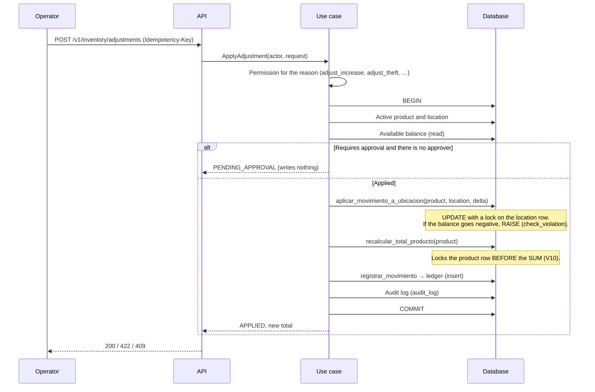
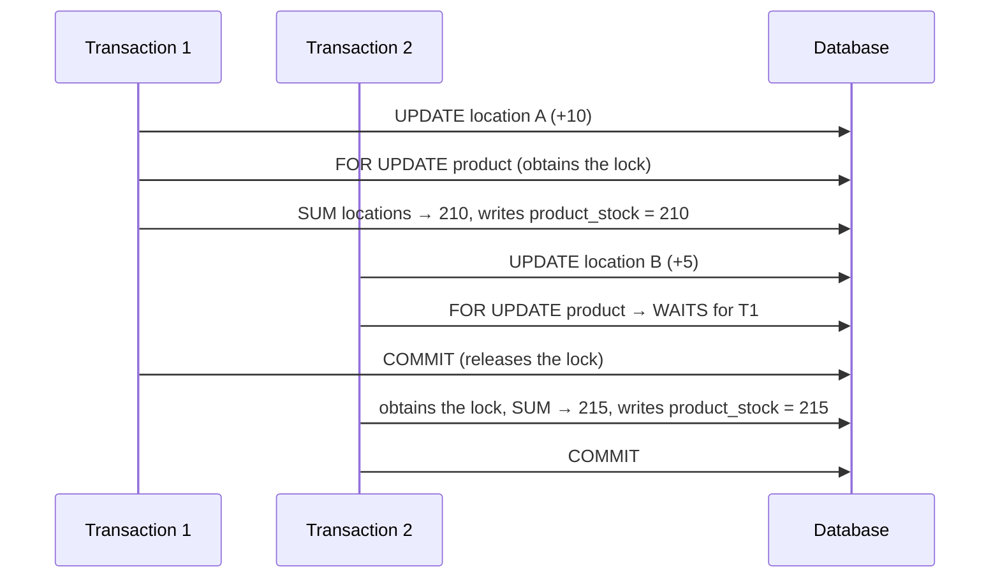

# Stock and adjustments
> **Normative.** Last revised: 2026-10-10 (A1–A10 green; see §7-bis). Origin rules: [ADR-0007](../adr/0007-multi-bodega-desde-el-esquema.md), [ADR-0008](../adr/0008-discrepancias-y-merma.md), [ADR-0009](../adr/0009-ubicacion-de-recepcion-real.md). Module: [M02](../modulos/M02-existencias/README.md).

## 1. Objective and actors

Know how much there is of each product and in which location, and be able to explain each change.

| Actor | What it does |
|---|---|
| Floor operator (app) | Locates received goods, moves between shelves, records shrinkage with a reason |
| Supervisor (web) | Approves adjustments that require it; queries stock and the ledger |
| Systems (other flows) | Receiving, picking and transfers call this flow; nobody writes stock from outside |

## 2. Preconditions

- The product and the location exist and are active ([catalogo.md](catalogo.md)).
- The location belongs to a warehouse.
- The caller has the permission for the movement type ([autenticacion-y-permisos.md](autenticacion-y-permisos.md) §5).

## 3. Data model (summary)

| Table | What it holds | Rule |
|---|---|---|
| `kardex` | Movement ledger | Only inserted. Never edited or deleted |
| `stock_by_location` | Stock per location | Projection; `quantity >= 0` |
| `product_stock` | Total per product | Projection: sum of locations plus unreceived transit |
| `stock_in_transit` | Goods in transfer | See [traslados.md](traslados.md) |

Every change to stock goes through the SQL engine functions
([ADR-0015](../adr/0015-postgresql-flyway-motor-en-sql.md)): `aplicar_movimiento_a_ubicacion`,
`recalcular_total_producto` and `registrar_movimiento`. The API does not write those tables directly.

## 4. Flow: apply a movement

A movement can be an adjustment (increase or shrinkage), a locate (from receiving to shelf) or a move
(from one shelf to another). The three follow the same path inside the engine.

**Why the order matters.** First it decides (permission, approval, balance), then it writes.
A movement that awaits approval **does not touch** the inventory: an unauthorized stock change is
exactly what approval prevents.

## 5. Concurrency: the total per product (Q1)

Two movements of the same product in different locations can run at the same time. Without locking the product, the
second recalculation does not see the change of the first and writes a total that ignores it.

Without the `FOR UPDATE` on line 3, T2 would write 205. That was the reproduced loss.

## 6. States

The movement has no states: it is inserted or it is not inserted. An adjustment has two outcomes:

| Outcome | When | What is written |
|---|---|---|
| `APPLIED` | The permission reaches, it does not require approval or it was already approved, and the balance is enough | Ledger, stock, total, audit log |
| `PENDING_APPROVAL` | The reason requires it and there is no approver | Nothing |

An adjustment `PENDING_APPROVAL` has no automatic transition: the supervisor approves it with their own
request, which goes through the complete flow again.

## 7. Acceptance tests

**A1. Locating does not change the total**
- Given a product with 1,000 units in receiving.
- When 300 are located on a shelf.
- Then the total remains at 1,000, the shelf has 300 and the ledger has a `LOCATE` movement.

**A2. You cannot take out more than there is**
- Given a shelf with 100 units.
- When a shrinkage of 150 is requested.
- Then it answers `INSUFFICIENT_STOCK` with `available = 100`, and the balance remains at 100.

**A3. The database prevents negative stock**
- Given two transactions that try to take 60 each from a shelf with 100.
- When they run at the same time.
- Then one is applied and the other fails with `INSUFFICIENT_STOCK`; the final balance is 40, never negative.

**A4. Concurrency of the total (Q1)**
- Given a product with 100 on shelf A and 100 on B.
- When two transactions add 10 on A and 5 on B, and the first keeps its transaction open.
- Then `product_stock` remains at 215, the same as the sum of the locations, and `comprobar_proyecciones()` returns no rows.

**A5. A shrinkage requires its reason**
- Given a decrease adjustment without a reason.
- When it is sent.
- Then it answers `REASON_REQUIRED`, and nothing is written.

**A6. The permission depends on the reason**
- Given a user with `inventory.adjust_count_error` but without `inventory.adjust_theft`.
- When they record a shrinkage due to theft.
- Then it answers 403; a count error is applied.

**A7. Different origin and destination**
- Given a locate movement where origin and destination are the same shelf.
- When it is sent.
- Then it answers `SAME_SOURCE_AND_DESTINATION` and nothing is written.

**A8. Idempotency**
- Given an adjustment sent with an `Idempotency-Key`.
- When it is resent with the same key.
- Then the ledger has a single movement and the response is the same.

**A9. The ledger only grows**
- Given an already recorded movement.
- When any flow attempts to modify or delete it.
- Then the database rejects it (immutability trigger).

**A10. Count and listing use the same filter**
- Given a date range with no movements.
- When the ledger is queried.
- Then `items` is empty and `totalItems` is 0.

### 7-bis. Status of these tests (2026-10-10)

All ten are automated and green. Eight over real HTTP in
`api/app/src/test/kotlin/dev/axzy/stock/app/InventoryFlowTest.kt` (A1, A2, A5, A6,
A7, A8, A10 and the approval), and **A3, A4 and A9 against the database with two real transactions**
in `InventoryEngineConcurrencyTest`: they are the ones that cannot be demonstrated
over HTTP without ceasing to be deterministic.

Four things the document did not state and were decided when building:

- **`SEGREGATION_OF_DUTIES` answers `403`, not `422`.** The error catalog
  groups it with the authorization family and the client does the same as with
  any denial: have it approved by another person. The table in
  [api/inventario.md](../api/inventario.md) said `422` and it was corrected there.
- **Locating requires the origin to be receiving and the destination a shelf; moving,
  that both are shelves.** Without that check, whoever can locate
  (`invoice.locate`) could reorganize the entire warehouse by calling `locate` with
  two shelves, which is what the separate permission from `inventory.move` aims to
  avoid.
- **A movement does not change warehouse.** That is what the transfer (M05) is for, the
  only one that knows how to put goods in transit. If origin and destination are in different
  warehouses, it is rejected with `INVALID_PARAMETER` and the rule in `details`.
- **`DISCREPANCY_NOT_APPROVED` is not emitted by this route.** The contract listed it in
  `locate`, but the body carries no invoice line —"There is no `invoiceLineId`"— and without it there is no
  discrepancy to consult. M03 emits it, since it is the one that knows the line.

## 8. Errors

| Code | When |
|---|---|
| `PRODUCT_NOT_FOUND` | The product does not exist or is inactive |
| `LOCATION_NOT_FOUND` | The location does not exist or is inactive |
| `INSUFFICIENT_STOCK` | Not enough balance; includes `available` |
| `REASON_REQUIRED` | The reason the rule requires is missing |
| `SAME_SOURCE_AND_DESTINATION` | Origin and destination are the same location |
| `PENDING_APPROVAL` | Not an error outcome: the adjustment awaits approval |

## 9. Permissions

| Action | Permission |
|---|---|
| View stock | `inventory.view` |
| View cost | `inventory.view_cost` (different from `inventory.view`) |
| View ledger | `kardex.view` |
| Locate and move | `inventory.move` and `invoice.locate` (see [autenticacion-y-permisos.md](autenticacion-y-permisos.md)) |
| Increase | `inventory.adjust_increase` |
| Shrinkage due to count | `inventory.adjust_count_error` |
| Shrinkage due to shortage | `inventory.adjust_shortage` |
| Shrinkage due to damage | `inventory.adjust_damage` |
| Shrinkage due to theft | `inventory.adjust_theft` |
| Approve adjustment | `inventory.approve_adjustment` (the server checks it on the user of the `approverId`) |

There is no generic "adjust" permission: a theft is not a count error, and a single permission
would allow covering a theft with an adjustment signed by whoever did it.

**And the approval permission is really checked.** The adjustment that requires approval carries the
`approverId` in the request, so the server loads that user and requires
`inventory.approve_adjustment` **with the scope of the location's warehouse**; if they do not have it,
it answers `403 APPROVER_NOT_AUTHORIZED` and writes nothing. Without this check it was enough to send
the identifier of a supervisor to sign one's own adjustment: the permission existed in the catalog,
in the roles and in the audit log, but nobody checked it. See
[PLAN-IMPLEMENTACION §6](../plan/PLAN-IMPLEMENTACION.md).

## 10. Audit log

Each applied adjustment writes to `audit_log`: actor, channel, IP, entity (product), previous and
new state (total before and after), reason, permission used and idempotency key. See
[auditoria.md](auditoria.md).

## 11. Rules and decisions

- Every difference is an adjustment with a reason and user, never a deletion: [ADR-0008](../adr/0008-discrepancias-y-merma.md).
- Locating is a new movement; receiving is a real location: [ADR-0009](../adr/0009-ubicacion-de-recepcion-real.md).
- The initial stock from the Excel enters `UNASSIGNED` and is reconciled with a count before the cutover: [ADR-0012](../adr/0012-conciliar-stock-heredado-con-conteo.md).
- Multi-warehouse from the schema: [ADR-0007](../adr/0007-multi-bodega-desde-el-esquema.md).
