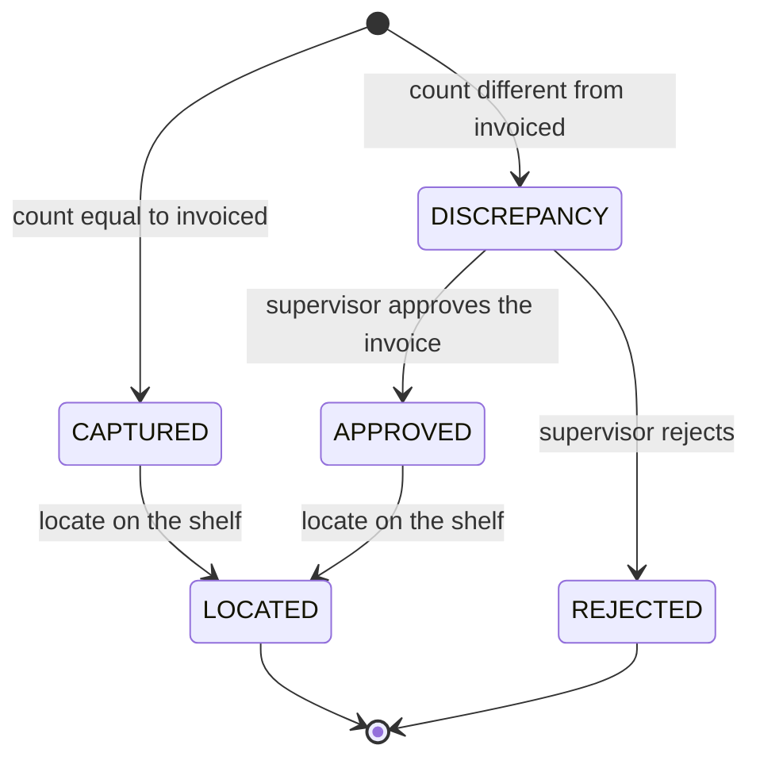
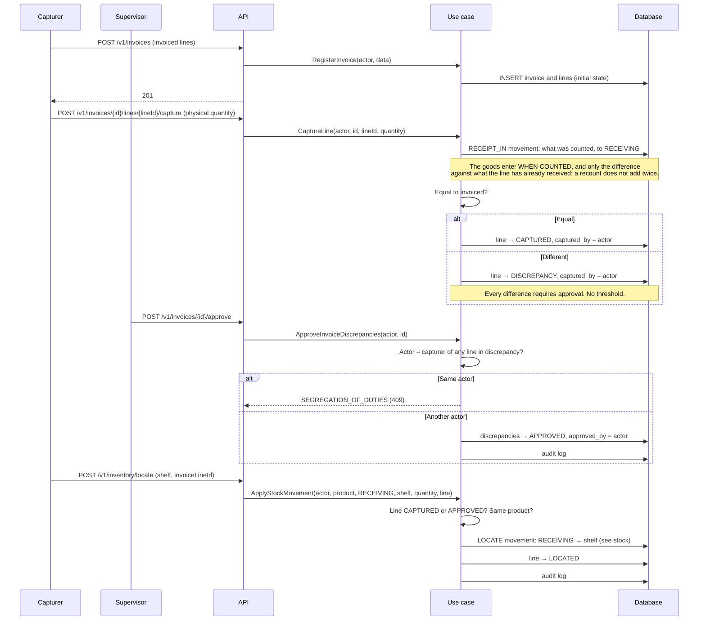

# Receiving: invoice, physical count and location
> **Normative.** Last revised: 2026-10-10 (R1–R8 green; see §6-bis). Origin rules: [ADR-0008](../adr/0008-discrepancias-y-merma.md), [ADR-0009](../adr/0009-ubicacion-de-recepcion-real.md). Module: [M03](../modulos/M03-recepcion/README.md).

## 1. Objective and actors

Record what arrives on an invoice, physically count each line, resolve the differences with a
supervisor and leave the goods located on their shelf.

| Actor | What it does |
|---|---|
| Capturer (app or web) | Creates the invoice and physically counts each line |
| Supervisor (web) | Approves or rejects the discrepancies of an invoice |
| Floor operator (app) | Locates the approved lines on their shelf |

## 2. Preconditions

- The `RECEIVING` location, the receiving one, exists and cannot be deactivated.
- The products on the invoice exist in the catalog.

## 3. Line states

A line in `DISCREPANCY` **cannot be located**. It only reaches `APPROVED` with the approval of a
supervisor, and the database prevents `APPROVED` from existing without `approved_by`.

## 4. Main flow

**Why approval is per invoice.** The supervisor resolves all the discrepancies of an invoice
in a single action. Approving line by line opened the door to approving the easy ones and leaving the
hard ones unresolved.

## 5. Closing the invoice

- An invoice is **closed** when no line is in `DISCREPANCY`.
- If closing is attempted with pending discrepancies, it answers `INVOICE_HAS_PENDING_LINES`.
- If approval is requested and nothing is pending, it answers `NO_PENDING_APPROVAL` (409), not 200.

## 6. Acceptance tests

**R1. A line in discrepancy cannot be located**
- Given a line captured with 8 when 10 were invoiced.
- When locating is attempted.
- Then it answers 409 and the inventory does not change.

**R2. Every difference requires approval, with no threshold**
- Given a difference of 1 unit.
- When it is captured.
- Then the line remains in `DISCREPANCY`.

**R3. Whoever captured does not approve their own discrepancy**
- Given a line captured by user U.
- When U approves the invoice.
- Then it answers `SEGREGATION_OF_DUTIES` and the line remains in `DISCREPANCY`.

**R4. The approval covers the whole invoice**
- Given an invoice with two discrepancies.
- When the supervisor approves once.
- Then both are `APPROVED` with the same approver.

**R5. It is not closed with pending items**
- Given an invoice with an unresolved discrepancy.
- When closing is attempted.
- Then it answers `INVOICE_HAS_PENDING_LINES`.

**R6. Approving with nothing pending**
- Given an invoice without discrepancies.
- When approval is requested.
- Then it answers `NO_PENDING_APPROVAL` (409).

**R7. Locating moves from receiving to the shelf and does not change the total**
- Given 10 units in `RECEIVING` and a `CAPTURED` line.
- When they are located on a shelf.
- Then the product total remains at 10, the shelf has 10, and `RECEIVING` has 0.

**R8. Pagination rejects invalid values**
- Given `page=-1`.
- When invoices are listed.
- Then it answers `INVALID_PAGINATION` (400), it does not trim the value silently.

### 6-bis. Status of these tests (2026-10-10)

**Who puts the goods into `RECEIVING` is the count** (2026-10-10). Before, nobody did:
the balance appeared through a manual adjustment or the M10 initial load, so locating
from `RECEIVING` found zero. Now the count writes a `RECEIPT_IN` for the **difference** between what was counted and what the line has already received, and if what was counted is less, the
difference leaves with an adjustment for a count error: the previous count was high. It is what makes
a recount —a line discarded by the supervisor returns to `PENDING`— not add the goods twice.

**The eight are automated and green over real HTTP**
(`api/app/src/test/kotlin/dev/axzy/stock/app/ReceivingFlowTest.kt`): R1 to R8, with R7 in
`InventoryFlowTest` A1 (locating moves from receiving to the shelf and does not change the total) and R1 in the
same test of the locate route, which loads the line, applies the domain rule **before
moving anything** and at the end notes what was located.

Additionally, for what this module writes:

- **The goods enter when counted**, and with that the module became the second one that moves inventory:
  it has its own concurrency tests (`ReceivingConcurrencyTest`) and its measured query budget —a listing is two
  statements and the detail of an invoice is two, with its lines—.

One thing the document took for granted and was not true:

- **Rejecting does not cancel the line: it returns it to `PENDING`.** The state diagram
  says `DISCREPANCY --> REJECTED`, but the `REJECTED` state does not exist in the database nor in
  the domain: what exists is `rejectDiscrepancy`, which clears the count to force a recount.
  Cancelling would leave a dead line and goods not counted. Corrected in
  [api/recepcion.md](../api/recepcion.md).
- **`physicalBoxQuantity` is an integer count of boxes.** The contract example
  had `1.600` for 80 pieces with boxes of 50: it was the decimal equivalent of the legacy,
  not a count. The domain models discrete boxes because "1 box and 30 loose" is what
  gets counted, and a value with a fraction is rejected.

## 7. Errors

| Code | HTTP | When |
|---|---|---|
| `INVOICE_NOT_FOUND` | 404 | The invoice does not exist or is deleted |
| `INVOICE_LINE_NOT_FOUND` | 404 | The line does not belong to the invoice |
| `LINE_IN_DISCREPANCY` | 409 | Attempt to locate a line pending approval |
| `SEGREGATION_OF_DUTIES` | 409 | The approver is whoever captured |
| `INVOICE_HAS_PENDING_LINES` | 409 | Attempt to close with discrepancies |
| `NO_PENDING_APPROVAL` | 409 | Nothing to approve |
| `INVALID_PAGINATION` | 400 | Invalid `page` or `size` |

## 8. Permissions

| Action | Permission |
|---|---|
| View invoices | `invoice.view` |
| Create | `invoice.create` |
| Capture | `invoice.capture` |
| Approve and reject | `invoice.approve`, `invoice.reject` |
| Close | `invoice.close` |
| Locate | `invoice.locate`, with scope `OWN` for the operator |

Segregation of duties is verified in the use case, not in the controller.

## 9. Audit log

Creating, capturing, approving, rejecting, locating and closing write to `audit_log`. Each record carries
the actor and the affected line.

## 10. Rules and decisions

- Every difference is a discrepancy with approval; the line is never deleted: [ADR-0008](../adr/0008-discrepancias-y-merma.md).
- The receiving location is a real location with an id, not a name: [ADR-0009](../adr/0009-ubicacion-de-recepcion-real.md).
- Locating is a movement: see [existencias-y-ajustes.md](existencias-y-ajustes.md).
