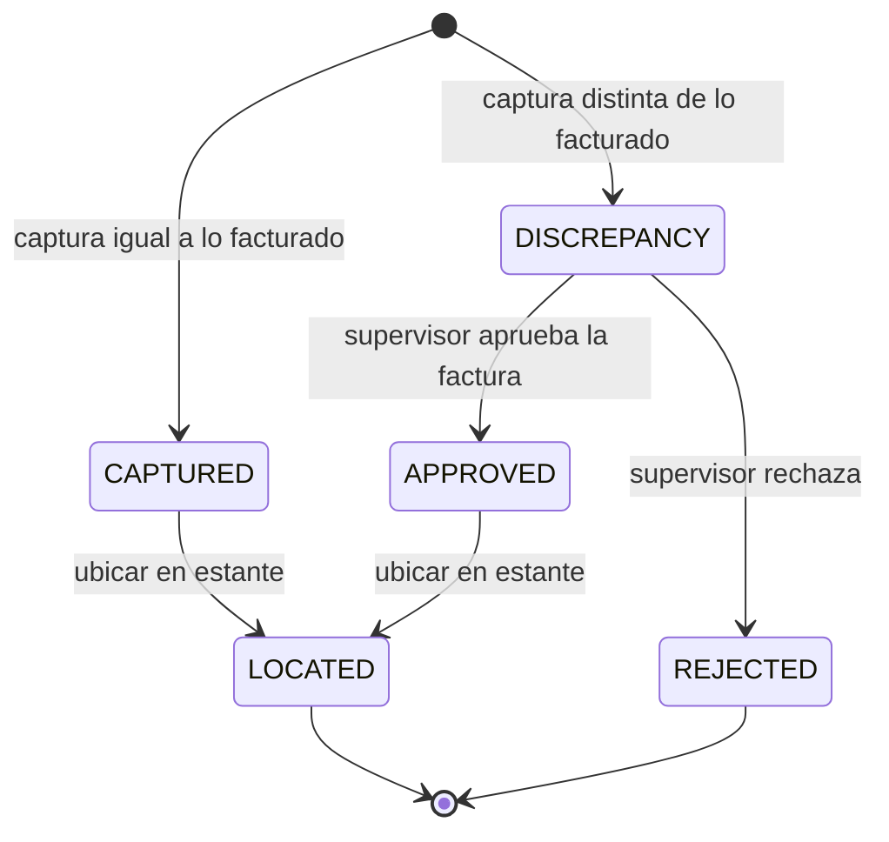
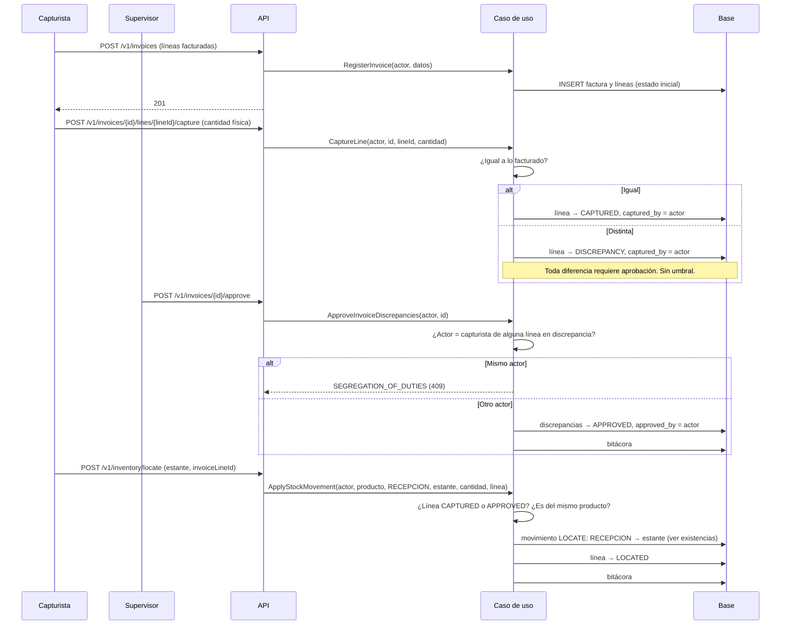

# Recepción: factura, captura física y ubicación
> **Normativo.** Última revisión: 2026-10-10 (R1–R8 en verde; ver §6-bis). Reglas de origen: [ADR-0008](../adr/0008-discrepancias-y-merma.md), [ADR-0009](../adr/0009-ubicacion-de-recepcion-real.md). Módulo: [M03](../modulos/M03-recepcion/README.md).

## 1. Objetivo y actores

Registrar lo que llega en una factura, contar físicamente cada línea, resolver las diferencias con un
supervisor y dejar la mercancía ubicada en su estante.

| Actor | Qué hace |
|---|---|
| Capturista (app o web) | Crea la factura y cuenta físicamente cada línea |
| Supervisor (web) | Aprueba o rechaza las discrepancias de una factura |
| Operador de piso (app) | Ubica las líneas aprobadas en su estante |

## 2. Precondiciones

- Existe la ubicación `RECEIVING`, la de recepción, y no se puede desactivar.
- Los productos de la factura existen en el catálogo.

## 3. Estados de la línea

Una línea en `DISCREPANCY` **no se puede ubicar**. Solo llega a `APPROVED` con la aprobación de un
supervisor, y la base impide que `APPROVED` exista sin `approved_by`.

## 4. Flujo principal

**Por qué la aprobación es por factura.** El supervisor resuelve todas las discrepancias de una factura
en una sola acción. Aprobar línea por línea abría la puerta a que se aprobara lo fácil y se dejara lo
difícil sin resolver.

## 5. Cierre de la factura

- Una factura se **cierra** cuando ninguna línea está en `DISCREPANCY`.
- Si se intenta cerrar con discrepancias pendientes, responde `INVOICE_HAS_PENDING_LINES`.
- Si se pide aprobar y no hay nada pendiente, responde `NO_PENDING_APPROVAL` (409), no 200.

## 6. Pruebas de aceptación

**R1. Una línea en discrepancia no se puede ubicar**
- Dado una línea capturada con 8 cuando se facturaron 10.
- Cuando se intenta ubicar.
- Entonces responde 409 y el inventario no cambia.

**R2. Toda diferencia pide aprobación, sin umbral**
- Dado una diferencia de 1 unidad.
- Cuando se captura.
- Entonces la línea queda en `DISCREPANCY`.

**R3. Quien capturó no aprueba su discrepancia**
- Dado una línea capturada por el usuario U.
- Cuando U aprueba la factura.
- Entonces responde `SEGREGATION_OF_DUTIES` y la línea sigue en `DISCREPANCY`.

**R4. La aprobación cubre toda la factura**
- Dado una factura con dos discrepancias.
- Cuando el supervisor aprueba una vez.
- Entonces ambas quedan `APPROVED` con el mismo aprobador.

**R5. No se cierra con pendientes**
- Dado una factura con una discrepancia sin resolver.
- Cuando se intenta cerrar.
- Entonces responde `INVOICE_HAS_PENDING_LINES`.

**R6. Aprobar sin pendientes**
- Dado una factura sin discrepancias.
- Cuando se pide aprobar.
- Entonces responde `NO_PENDING_APPROVAL` (409).

**R7. Ubicar mueve de recepción al estante y no cambia el total**
- Dado 10 unidades en `RECEIVING` y una línea `CAPTURED`.
- Cuando se ubican en un estante.
- Entonces el total del producto sigue en 10, el estante tiene 10, y `RECEIVING` tiene 0.

**R8. La paginación rechaza valores inválidos**
- Dado `page=-1`.
- Cuando se lista facturas.
- Entonces responde `INVALID_PAGINATION` (400), no recorta el valor en silencio.

### 6-bis. Estado de estas pruebas (2026-10-10)

Cinco de las ocho están automatizadas y en verde por HTTP real
(`api/app/src/test/kotlin/dev/axzy/stock/app/ReceivingFlowTest.kt`): R2, R3, R4, R5,
R6 y R8. Las otras dos:

- **R7** (ubicar mueve de recepción al estante y no cambia el total) está cubierta en
  el flujo de inventario: es `InventoryFlowTest` A1, con el mismo escenario.
- **R1** (una línea en discrepancia no se puede ubicar) está cubierta: la ruta de
  ubicar recibe un `invoiceLineId` opcional, carga la línea, aplica la regla del
  dominio **antes de mover nada** y, al terminar, anota lo ubicado y la deja `LOCATED`
  cuando no queda nada pendiente.
- **R7** (ubicar no cambia el total) está en la misma prueba, que además comprueba que
  la mercancía sale de `RECEPCION` y entra en el estante.

Tres cosas que el documento daba por hechas y no lo estaban:

Dos cosas que el documento daba por hechas y no lo estaban:

- **Rechazar no cancela la línea: la devuelve a `PENDING`.** El diagrama de estados
  dice `DISCREPANCY --> REJECTED`, pero no existe el estado `REJECTED` en la base ni en
  el dominio: lo que existe es `rejectDiscrepancy`, que limpia el conteo para forzar un
  reconteo. Cancelar dejaría una línea muerta y mercancía sin contar. Corregido en
  [api/recepcion.md](../api/recepcion.md).
- **`physicalBoxQuantity` es una cuenta entera de cajas.** El ejemplo del contrato
  traía `1.600` para 80 piezas con cajas de 50: era el equivalente decimal del legacy,
  no un conteo. El dominio modela cajas discretas porque «1 caja y 30 sueltas» es lo
  que se cuenta, y un valor con fracción se rechaza.

## 7. Errores

| Código | HTTP | Cuándo |
|---|---|---|
| `INVOICE_NOT_FOUND` | 404 | La factura no existe o está eliminada |
| `INVOICE_LINE_NOT_FOUND` | 404 | La línea no pertenece a la factura |
| `LINE_IN_DISCREPANCY` | 409 | Se intenta ubicar una línea pendiente de aprobación |
| `SEGREGATION_OF_DUTIES` | 409 | El aprobador es quien capturó |
| `INVOICE_HAS_PENDING_LINES` | 409 | Se intenta cerrar con discrepancias |
| `NO_PENDING_APPROVAL` | 409 | No hay nada que aprobar |
| `INVALID_PAGINATION` | 400 | `page` o `size` inválidos |

## 8. Permisos

| Acción | Permiso |
|---|---|
| Ver facturas | `invoice.view` |
| Crear | `invoice.create` |
| Capturar | `invoice.capture` |
| Aprobar y rechazar | `invoice.approve`, `invoice.reject` |
| Cerrar | `invoice.close` |
| Ubicar | `invoice.locate`, con alcance `OWN` para el operador |

La segregación de funciones se verifica en el caso de uso, no en el controlador.

## 9. Bitácora

Crear, capturar, aprobar, rechazar, ubicar y cerrar escriben en `audit_log`. Cada registro lleva el
actor y la línea afectada.

## 10. Reglas y decisiones

- Toda diferencia es una discrepancia con aprobación; nunca se borra la línea: [ADR-0008](../adr/0008-discrepancias-y-merma.md).
- La recepción es una ubicación real con id, no un nombre: [ADR-0009](../adr/0009-ubicacion-de-recepcion-real.md).
- Ubicar es un movimiento: ver [existencias-y-ajustes.md](existencias-y-ajustes.md).
