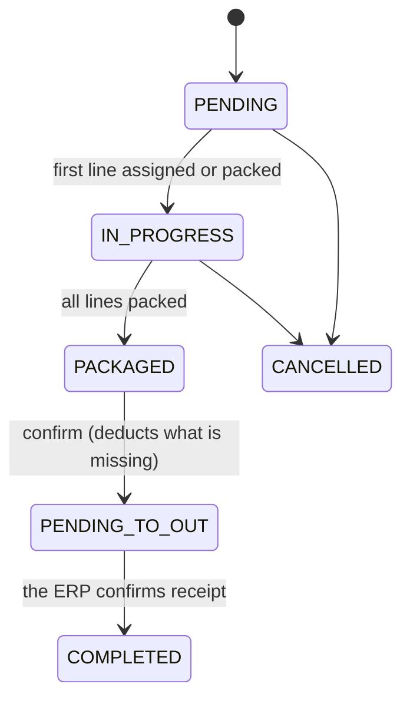

# Picking and export to the ERP
> **Normative.** Last revised: 2026-10-09. Origin rules: [ADR-0008](../adr/0008-discrepancias-y-merma.md) (shortages) and [ADR-0013](../adr/0013-ordenes-al-erp-con-reintentos.md) (ERP). Module: [M04](../modulos/M04-surtido/README.md).

## 1. Objective and actors

Pick an order: assign stock to each line, pack it, confirm it, and return it to the ERP.

| Actor | What it does |
|---|---|
| Floor operator (app) | Assigns location, packs quantities, records shortages |
| Supervisor (web) | Confirms the order, queries and retries the export |
| ERP (external) | Receives the confirmed order. **There is still no integration** (D10 pending) |

## 2. Preconditions

- The order exists, has lines and its product is active.
- To pack, the line has a location to leave from (or the product has stock somewhere).

## 3. States

Order:



- `PENDING_TO_OUT` is the normal state while the ERP does not exist or has not responded. **A confirmed order
  without an ERP stays here**, not in `COMPLETED`.
- `COMPLETED` is only reached when the ERP confirms. While the ERP client does not exist, no order
  reaches `COMPLETED` through export.
- An exported order is not cancelled: the ERP has an outflow that the system would stop recognizing. To undo it,
  an inflow is recorded.

Line: `PENDING` → `ASSIGNED` → `SUPPLIED`, or `CANCELLED` from `PENDING` or `ASSIGNED`.

**`PENDING` → `ASSIGNED` is written by `PUT /v1/orders/{id}/lines/{lineId}/assign`** (permission
`order.assign`), which assigns the line to a person and, if indicated, to a shelf. Packing
also leaves the line in `ASSIGNED` when it picks part of it. Reassigning while it is in
progress is allowed; on a line already picked or voided it answers `INVALID_TRANSITION`.

**Deduction rule.** `supplied_quantity` is **always** what has already been deducted from the inventory. Packing
deducts what was packed. Confirming deducts **what is missing**: `quantity − supplied_quantity`. If
it confirmed the whole `quantity`, a line of 10 with 7 packed would deduct 17.

## 4. Flow: confirm

Confirming is the only operation that deducts the inventory for the rest of the order. It runs in a
transaction that locks the order, so that two simultaneous confirmations do not deduct twice (Q3).

```mermaid
sequenceDiagram
    participant Op as Supervisor
    participant API
    participant UC as ConfirmOrder
    participant DB as Database

    Op->>API: POST /v1/orders/{id}/confirm (Idempotency-Key)
    API->>UC: ConfirmOrder(actor, orderId, key)
    UC->>DB: BEGIN
    UC->>DB: SELECT order FOR UPDATE
    Note over DB: Locks the order. A second confirmation waits here.
    UC->>UC: Does the state allow confirming? (if not, 409)
    loop Each line not cancelled with pending > 0
        UC->>DB: Available balance at the location
        alt Insufficient balance
            UC-->>API: INSUFFICIENT_STOCK (ROLLBACK, nothing is deducted)
        else Enough
            UC->>DB: registrar_movimiento FULFILLMENT_OUT<br/>client_uuid = UUID(order, line)
            Note over DB: If that client_uuid already exists, the unique index<br/>rejects the duplicate: the line was already deducted.
        end
    end
    UC->>DB: order → PENDING_TO_OUT
    UC->>DB: Audit log
    UC->>DB: COMMIT
    UC->>UC: export (see §5); its failure does NOT revert the confirmation
    UC-->>API: confirmed order + export status
    API-->>Op: 200
```

**Why the movement key is deterministic.** `client_uuid` is calculated from the order and the
line, it is not random. That way, if the same confirmation arrives twice (double click, network retry),
the second one cannot insert a new movement: the unique index prevents it. With a random key,
the index protected nothing (the previous version used `UUID.randomUUID()` when there was no key).

## 5. Flow: export to the ERP

The export **does not block picking**: if the ERP fails, the order stays `PENDING_TO_OUT` with the
attempt recorded, and it is retried (ADR-0013).

```mermaid
sequenceDiagram
    participant UC as ExportOrderToErp
    participant Gw as ErpGateway (port)
    participant DB as Database

    UC->>DB: Read confirmed order
    UC->>Gw: send(order, Idempotency-Key = orderNumber)
    alt The ERP responds OK
        Gw-->>UC: success, external_id
        UC->>DB: export_status = SENT; converted = true
    else No client or the ERP fails
        Gw-->>UC: failure with reason
        UC->>DB: export_status = FAILED; export_attempts + 1; export_last_error = reason
        Note over DB: The order remains PENDING_TO_OUT and converted = false
    end
```

**Today only the `ErpGateway` port exists, without a real client.** Its adapter returns the failure
`ERP_NOT_CONNECTED` with the text: "the ERP integration does not exist yet". That is the honest behavior until there is an ERP: recording `SENT` without sending anything would count as exported
orders that the ERP never received, and the retry would never be triggered.

**Retries.** The manual retry (`POST /v1/orders/{id}/export`) requires `converted = false` and state
`PENDING_TO_OUT`. Each attempt increments `export_attempts`. The automatic retry with backoff is
added when the real client exists; not before.

**Idempotency of the dispatch.** The key is the order number. If the ERP already has the order, it answers with
the same one and the system marks it as sent: it does not create a second outflow.

## 6. Shortages

A shortage is an **adjustment**, not a line deletion. It is recorded with the adjustments use case
(`ApplyAdjustment`) with origin `FULFILLMENT_SHORTAGE`, so it follows the same permission and reason
rules as any shrinkage ([existencias-y-ajustes.md](existencias-y-ajustes.md)). There is a single
adjustment rule; picking does not reimplement its own.

## 7. Acceptance tests

**S1. Packing deducts exactly what was packed**
- Given a line of 10 and 100 in stock.
- When 7 are packed.
- Then the inventory drops by 7 (it remains at 93) and the line is left with `supplied = 7`.

**S2. Confirming deducts only what is missing (Q3 base)**
- Given a line of 10 with 7 already packed.
- When it is confirmed.
- Then the inventory drops 3 more (not 10), and the line is left with `supplied = 10`.

**S3. Confirming twice does not deduct twice (Q3)**
- Given an order ready to confirm.
- When it is confirmed twice in parallel with the same key.
- Then the inventory drops only once, and one of the two responses is 409 or the same order already confirmed.

**S4. Confirming without stock leaves nothing half done**
- Given a line that needs 10 and a location with 4.
- When it is confirmed.
- Then it answers `INSUFFICIENT_STOCK` with `available = 4`, the order remains `PACKAGED` and no movement was written.

**S5. Without an ERP, the export fails with a reason (Q2)**
- Given a confirmed order and no ERP client configured.
- When it is confirmed.
- Then the order is `PENDING_TO_OUT`, `converted = false`, `export_status = FAILED`,
  `export_attempts = 1`, and `export_last_error` starts with `ERP_NOT_CONNECTED`. The inventory was deducted.

**S6. The manual retry fails again with a reason and counts the attempt**
- Given an order from the previous case.
- When `POST /export` is requested.
- Then it answers `FAILED`, `attempts = 2`, and the reason is still `ERP_NOT_CONNECTED`.

**S7. An unconfirmed order is not exported**
- Given a `PENDING` order.
- When export is requested.
- Then it answers `ORDER_NOT_CONVERTED` (409).

**S8. A shortage follows the adjustment rules**
- Given a shortage without a reason, or with a user without `inventory.adjust_shortage`.
- When it is recorded.
- Then it answers `REASON_REQUIRED` or 403, and nothing is deducted.

**S9. An exported order is not cancelled**
- Given an order with `converted = true`.
- When cancellation is attempted.
- Then it answers `INVALID_TRANSITION`, with no changes.

### 7-bis. Status of these tests (2026-10-10)

Eight of the nine are green: S1–S8 over real HTTP
(`api/app/src/test/kotlin/dev/axzy/stock/app/FulfillmentFlowTest.kt`) and S3 also with
**two real transactions** against the database
(`FulfillmentPersistenceTest`), which is where it is shown that the conditional claim
of the confirmation is not taken by both.

- **S9** (an exported order is not cancelled) is covered in the **domain**:
  `Order.cancel()` returns `INVALID_TRANSITION` when the order is `COMPLETED`. There is no
  HTTP test because **the M04 contract does not define any cancellation route**.

Two things the contract said and could not be:

- **The shortage requires a reason.** The table said "`reason` is `SHORTAGE` by default" and
  S8 requires `REASON_REQUIRED` without it. If there were a default, the delegated adjustment would never
  see a missing reason and the single adjustment rule would be left half-done. Corrected in
  [api/surtido.md](../api/surtido.md).
- **Without an ERP the attempt fails, it is not recorded as sent.** The contract said "the
  attempt is recorded as sent"; S5 and S6 say it stays `FAILED` with the reason
  `ERP_NOT_CONNECTED` and the counter going up. What the tests say was implemented.

## 8. Errors

| Code | When |
|---|---|
| `ORDER_NOT_FOUND` | The order does not exist |
| `ORDER_LINE_NOT_FOUND` | The line does not belong to the order |
| `INSUFFICIENT_STOCK` | There is no balance to deduct; includes `available` and `lineId` |
| `LOCATION_REQUIRED` | The line has nowhere to leave from |
| `ORDER_NOT_CONVERTED` | Export of an unconfirmed order is requested |
| `ORDER_ALREADY_CONFIRMED` | An already confirmed order is confirmed |
| `ERP_NOT_CONNECTED` | Reason for the export failure while there is no ERP (state `FAILED`, not an HTTP error) |

## 9. Permissions

| Action | Permission |
|---|---|
| View orders | `order.view` |
| Create | `order.create` |
| Pack | `order.package` |
| Confirm | `order.confirm` |
| Export and retry | `order.convert` (different from confirming: export sends data outside the system) |
| Shortage | `inventory.adjust_shortage` (the adjustments one) |

## 10. Audit log

Packing, confirming, exporting (with its result) and recording a shortage write to `audit_log`.
A failed attempt is also recorded: it is information that is lost if only success is saved.

## 11. Rules and decisions

- A shortage is an adjustment with a reason: [ADR-0008](../adr/0008-discrepancias-y-merma.md).
- The export does not block picking and is retried: [ADR-0013](../adr/0013-ordenes-al-erp-con-reintentos.md).
- The ERP's `external_id` remains pending (D10 in [plan/PLAN-REHACER.md](../plan/PLAN-REHACER.md)).
