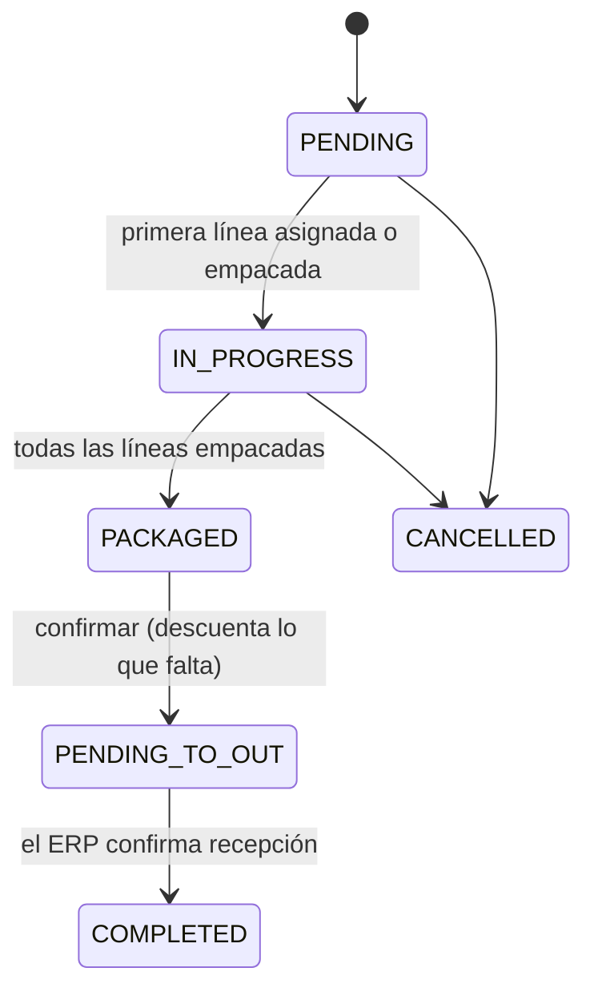

# Surtido y exportación al ERP
> **Normativo.** Última revisión: 2026-10-09. Reglas de origen: [ADR-0008](../adr/0008-discrepancias-y-merma.md) (faltantes) y [ADR-0013](../adr/0013-ordenes-al-erp-con-reintentos.md) (ERP). Módulo: [M04](../modulos/M04-surtido/README.md).

## 1. Objetivo y actores

Surtir una orden: asignar existencias a cada línea, empacarla, confirmarla, y devolverla al ERP.

| Actor | Qué hace |
|---|---|
| Operador de piso (app) | Asigna ubicación, empaca cantidades, registra faltantes |
| Supervisor (web) | Confirma la orden, consulta y reintenta la exportación |
| ERP (externo) | Recibe la orden confirmada. **Todavía no hay integración** (D10 pendiente) |

## 2. Precondiciones

- La orden existe, tiene líneas y su producto está activo.
- Para empacar, la línea tiene una ubicación de la que salir (o el producto tiene existencias en alguna).

## 3. Estados

Orden:



- `PENDING_TO_OUT` es el estado normal mientras el ERP no existe o no ha respondido. **Una orden
  confirmada sin ERP queda aquí**, no en `COMPLETED`.
- `COMPLETED` solo se alcanza cuando el ERP confirma. Mientras no exista el cliente del ERP, ninguna
  orden llega a `COMPLETED` por exportación.
- Una orden exportada no se cancela: el ERP tiene una salida que el sistema dejaría de reconocer. Para
  deshacerla se registra una entrada.

Línea: `PENDING` → `ASSIGNED` → `SUPPLIED`, o `CANCELLED` desde `PENDING` o `ASSIGNED`.

**`PENDING` → `ASSIGNED` lo escribe `PUT /v1/orders/{id}/lines/{lineId}/assign`** (permiso
`order.assign`), que asigna la línea a una persona y, si se indica, a una estantería. El
empaque también deja la línea en `ASSIGNED` cuando surte una parte. Reasignar mientras está en
curso se permite; sobre una línea ya surtida o anulada responde `INVALID_TRANSITION`.

**Regla del descuento.** `supplied_quantity` es **siempre** lo ya descontado del inventario. Empacar
descuenta lo empacado. Confirmar descuenta **lo que falta**: `quantity − supplied_quantity`. Si
confirmara `quantity` entera, una línea de 10 con 7 empacadas descontaría 17.

## 4. Flujo: confirmar

Confirmar es la única operación que descuenta el inventario del resto de la orden. Corre en una
transacción que bloquea la orden, para que dos confirmaciones simultáneas no descuenten dos veces (Q3).

```mermaid
sequenceDiagram
    participant Op as Supervisor
    participant API
    participant UC as ConfirmOrder
    participant DB as Base

    Op->>API: POST /v1/orders/{id}/confirm (Idempotency-Key)
    API->>UC: ConfirmOrder(actor, orderId, key)
    UC->>DB: BEGIN
    UC->>DB: SELECT orden FOR UPDATE
    Note over DB: Bloquea la orden. Una segunda confirmación espera aquí.
    UC->>UC: ¿Estado permite confirmar? (si no, 409)
    loop Cada línea no cancelada con pendiente > 0
        UC->>DB: Saldo disponible en la ubicación
        alt Saldo insuficiente
            UC-->>API: INSUFFICIENT_STOCK (ROLLBACK, nada se descuenta)
        else Alcanza
            UC->>DB: registrar_movimiento FULFILLMENT_OUT<br/>client_uuid = UUID(orden, línea)
            Note over DB: Si ya existe ese client_uuid, el índice único<br/>rechaza el duplicado: la línea ya se descontó.
        end
    end
    UC->>DB: orden → PENDING_TO_OUT
    UC->>DB: Bitácora
    UC->>DB: COMMIT
    UC->>UC: exportar (ver §5); su fallo NO revierte la confirmación
    UC-->>API: orden confirmada + estado de exportación
    API-->>Op: 200
```

**Por qué la clave de movimiento es determinista.** `client_uuid` se calcula a partir de la orden y la
línea, no es aleatorio. Así, si la misma confirmación llega dos veces (doble clic, reintento de red),
la segunda no puede insertar un movimiento nuevo: el índice único lo impide. Con una clave aleatoria,
el índice no protegía nada (la versión anterior usaba `UUID.randomUUID()` cuando no había clave).

## 5. Flujo: exportar al ERP

La exportación **no bloquea el surtido**: si el ERP falla, la orden queda `PENDING_TO_OUT` con el
intento registrado, y se reintenta (ADR-0013).

```mermaid
sequenceDiagram
    participant UC as ExportOrderToErp
    participant Gw as ErpGateway (puerto)
    participant DB as Base

    UC->>DB: Leer orden confirmada
    UC->>Gw: enviar(orden, Idempotency-Key = orderNumber)
    alt El ERP responde OK
        Gw-->>UC: éxito, external_id
        UC->>DB: export_status = SENT; converted = true
    else No hay cliente o el ERP falla
        Gw-->>UC: fallo con motivo
        UC->>DB: export_status = FAILED; export_attempts + 1; export_last_error = motivo
        Note over DB: La orden sigue PENDING_TO_OUT y converted = false
    end
```

**Hoy solo existe el puerto `ErpGateway` sin cliente real.** Su adaptador devuelve el fallo
`ERP_NOT_CONNECTED` con el texto: «la integración con el ERP todavía no existe». Ese es el
comportamiento honesto hasta que haya un ERP: registrar `SENT` sin enviar nada daría por exportadas
órdenes que el ERP nunca recibió, y el reintento nunca se dispararía.

**Reintentos.** El reintento manual (`POST /v1/orders/{id}/export`) exige `converted = false` y estado
`PENDING_TO_OUT`. Cada intento incrementa `export_attempts`. El reintento automático con backoff se
añade cuando exista el cliente real; no antes.

**Idempotencia del envío.** La clave es el número de orden. Si el ERP ya tiene la orden, responde con
la misma y el sistema la marca como enviada: no crea una segunda salida.

## 6. Faltantes

Un faltante es un **ajuste**, no un borrado de línea. Se registra con el caso de uso de ajustes
(`ApplyAdjustment`) con origen `FULFILLMENT_SHORTAGE`, así que sigue las mismas reglas de permiso y
motivo que cualquier merma ([existencias-y-ajustes.md](existencias-y-ajustes.md)). Hay una sola regla
de ajuste; el surtido no reimplementa la suya.

## 7. Pruebas de aceptación

**S1. Empacar descuenta exactamente lo empacado**
- Dado una línea de 10 y 100 en existencias.
- Cuando se empacan 7.
- Entonces el inventario baja 7 (queda en 93) y la línea queda con `supplied = 7`.

**S2. Confirmar descuenta solo lo que falta (Q3 base)**
- Dado una línea de 10 con 7 ya empacadas.
- Cuando se confirma.
- Entonces el inventario baja 3 más (no 10), y la línea queda con `supplied = 10`.

**S3. Confirmar dos veces no descuenta dos veces (Q3)**
- Dado una orden lista para confirmar.
- Cuando se confirma dos veces en paralelo con la misma clave.
- Entonces el inventario baja una sola vez, y una de las dos respuestas es 409 o la misma orden ya confirmada.

**S4. Confirmar sin existencias no deja nada a medias**
- Dado una línea que necesita 10 y una ubicación con 4.
- Cuando se confirma.
- Entonces responde `INSUFFICIENT_STOCK` con `available = 4`, la orden sigue `PACKAGED` y ningún movimiento se escribió.

**S5. Sin ERP, la exportación falla con motivo (Q2)**
- Dado una orden confirmada y ningún cliente de ERP configurado.
- Cuando se confirma.
- Entonces la orden queda `PENDING_TO_OUT`, `converted = false`, `export_status = FAILED`,
  `export_attempts = 1`, y `export_last_error` empieza por `ERP_NOT_CONNECTED`. El inventario sí quedó descontado.

**S6. El reintento manual vuelve a fallar con motivo y cuenta el intento**
- Dado una orden del caso anterior.
- Cuando se pide `POST /export`.
- Entonces responde `FAILED`, `attempts = 2`, y el motivo sigue siendo `ERP_NOT_CONNECTED`.

**S7. No se exporta una orden sin confirmar**
- Dado una orden `PENDING`.
- Cuando se pide exportar.
- Entonces responde `ORDER_NOT_CONVERTED` (409).

**S8. Un faltante sigue las reglas de ajuste**
- Dado un faltante sin motivo, o con un usuario sin `inventory.adjust_shortage`.
- Cuando se registra.
- Entonces responde `REASON_REQUIRED` o 403, y no se descuenta nada.

**S9. Una orden exportada no se cancela**
- Dado una orden con `converted = true`.
- Cuando se intenta cancelar.
- Entonces responde `INVALID_TRANSITION`, sin cambios.

### 7-bis. Estado de estas pruebas (2026-10-10)

Ocho de las nueve están en verde: S1–S8 por HTTP real
(`api/app/src/test/kotlin/dev/axzy/stock/app/FulfillmentFlowTest.kt`) y S3 además con
**dos transacciones de verdad** contra la base
(`FulfillmentPersistenceTest`), que es donde se demuestra que el reclamo condicional de
la confirmación no se lo llevan las dos.

- **S9** (una orden exportada no se cancela) está cubierta en el **dominio**:
  `Order.cancel()` devuelve `INVALID_TRANSITION` cuando la orden está `COMPLETED`. No
  hay prueba por HTTP porque **el contrato de M04 no define ninguna ruta de anulación**.

Dos cosas que el contrato decía y no podían ser:

- **El faltante exige motivo.** La tabla decía «`reason` es `SHORTAGE` por defecto» y
  S8 exige `REASON_REQUIRED` sin él. Si hubiera defecto, el ajuste delegado nunca
  vería un motivo ausente y la regla única de ajuste quedaría a medias. Corregido en
  [api/surtido.md](../api/surtido.md).
- **Sin ERP el intento falla, no se registra como enviado.** El contrato decía «el
  intento se registra como enviado»; S5 y S6 dicen que queda `FAILED` con el motivo
  `ERP_NOT_CONNECTED` y el contador subiendo. Se implementó lo que dicen las pruebas.

## 8. Errores

| Código | Cuándo |
|---|---|
| `ORDER_NOT_FOUND` | La orden no existe |
| `ORDER_LINE_NOT_FOUND` | La línea no pertenece a la orden |
| `INSUFFICIENT_STOCK` | No hay saldo para descontar; incluye `available` y `lineId` |
| `LOCATION_REQUIRED` | La línea no tiene de dónde salir |
| `ORDER_NOT_CONVERTED` | Se pide exportar una orden sin confirmar |
| `ORDER_ALREADY_CONFIRMED` | Se confirma una orden ya confirmada |
| `ERP_NOT_CONNECTED` | Motivo del fallo de exportación mientras no hay ERP (estado `FAILED`, no error HTTP) |

## 9. Permisos

| Acción | Permiso |
|---|---|
| Ver órdenes | `order.view` |
| Crear | `order.create` |
| Empacar | `order.package` |
| Confirmar | `order.confirm` |
| Exportar y reintentar | `order.convert` (distinto de confirmar: la exportación manda datos fuera del sistema) |
| Faltante | `inventory.adjust_shortage` (el de ajustes) |

## 10. Bitácora

Empacar, confirmar, exportar (con su resultado) y registrar un faltante escriben en `audit_log`.
Un intento fallido también se registra: es información que se pierde si solo se guarda el éxito.

## 11. Reglas y decisiones

- Un faltante es un ajuste con motivo: [ADR-0008](../adr/0008-discrepancias-y-merma.md).
- La exportación no bloquea el surtido y se reintenta: [ADR-0013](../adr/0013-ordenes-al-erp-con-reintentos.md).
- `external_id` del ERP sigue pendiente (D10 en [plan/PLAN-REHACER.md](../plan/PLAN-REHACER.md)).
