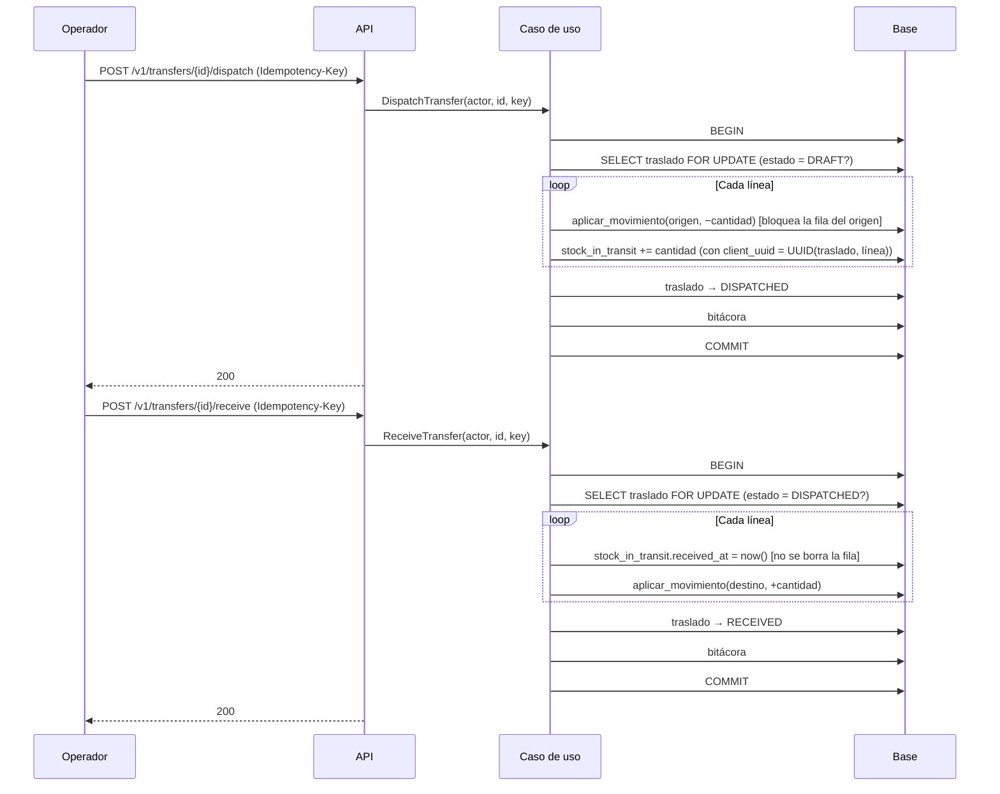

# Traslados: entre ubicaciones y entre bodegas
> **Normativo.** Última revisión: 2026-10-09. Reglas de origen: [ADR-0007](../adr/0007-multi-bodega-desde-el-esquema.md). Módulo: [M05](../modulos/M05-traslados/README.md). **El legacy no tiene traslado entre bodegas**: solo movimientos de ubicación. Ver [análisis](../analisis/legacy-entradas-salidas-ajustes-traslados.md) §1.

## 1. Objetivo y actores

Mover existencias de una ubicación a otra, o de una bodega a otra. La mercancía que va en camino se
cuenta como **tránsito** hasta que llega, para que el total no baje ni suba mientras se mueve.

| Actor | Qué hace |
|---|---|
| Operador (app o web) | Crea el traslado, lo despacha, lo recibe |
| Supervisor (web) | Cancela traslados; consulta la mercancía en tránsito |

## 2. Precondiciones

- Origen y destino son ubicaciones activas. Si son de bodegas distintas, son bodegas distintas.
- Hay existencias disponibles en el origen para cada línea.

## 3. Estados

```mermaid
stateDiagram-v2
    [*] --> DRAFT
    DRAFT --> DISPATCHED: despachar (sale del origen)
    DISPATCHED --> RECEIVED: recibir (entra al destino)
    DRAFT --> CANCELLED
    DISPATCHED --> CANCELLED: solo si nadie lo recibió; devuelve al origen
    RECEIVED --> [*]
    CANCELLED --> [*]
```

## 4. Flujo: despachar y recibir

Despachar **mueve la mercancía del origen al tránsito**. Recibir la **mueve del tránsito al destino**.
En ningún momento existe una mercancía que no esté contada.

**Por qué `FOR UPDATE` sobre el traslado.** Dos «recibir» simultáneos sobre el mismo traslado
moverían la mercancía dos veces. El bloqueo hace que el segundo vea `RECEIVED` y responda 409. La
misma razón aplica a despachar. Es el mismo patrón que la confirmación de una orden (Q8).

**Por qué el tránsito no se borra al recibir.** La fila queda con `received_at`. El total del producto
suma solo el tránsito **no recibido**; sin esa condición, la mercancía recibida contaría dos veces
(ya está en el destino y en el tránsito histórico). Es la razón del `WHERE received_at IS NULL` en el
recálculo del total.

## 5. Cancelación

- Cancelar un traslado en `DRAFT` no mueve nada.
- Cancelar un traslado `DISPATCHED` devuelve la mercancía al origen con un movimiento compensatorio y
  marca el tránsito como cancelado. No se borra nada (Q6).
- Un traslado `RECEIVED` no se cancela: para deshacerlo se hace un traslado nuevo en sentido contrario.

## 6. Pruebas de aceptación

**T1. Despachar saca del origen y pone en tránsito, sin cambiar el total**
- Dado un origen con 50 y un traslado de 20 en `DRAFT`.
- Cuando se despacha.
- Entonces el origen tiene 30, el tránsito 20 y el total sigue en 50.

**T2. Recibir pone en el destino sin cambiar el total**
- Dado el traslado del caso anterior en `DISPATCHED`.
- Cuando se recibe.
- Entonces el destino tiene 20, el tránsito no suma (`received_at` informado) y el total sigue en 50.

**T3. Recibir dos veces no mueve la mercancía dos veces**
- Dado un traslado `DISPATCHED`.
- Cuando se recibe dos veces en paralelo.
- Entonces el destino recibe 20 una sola vez; la segunda respuesta es 409.

**T4. El origen y el destino de la misma bodega no son un traslado entre bodegas**
- Dado un traslado entre bodegas con origen y destino de la misma bodega.
- Cuando se crea.
- Entonces responde `SAME_WAREHOUSE_TRANSFER` (422) y no se escribe nada.

**T5. Sin existencias en el origen, no se despacha**
- Dado un origen con 10 y un traslado de 20.
- Cuando se despacha.
- Entonces responde `INSUFFICIENT_STOCK` con `available = 10`, y el traslado sigue en `DRAFT`.

**T6. Cancelar un despachado devuelve la mercancía**
- Dado un traslado `DISPATCHED` de 20.
- Cuando se cancela.
- Entonces el origen recupera 20, el tránsito queda cancelado, el total no cambia y la bitácora registra la cancelación.

**T7. Un traslado recibido no se cancela**
- Dado un traslado `RECEIVED`.
- Cuando se intenta cancelar.
- Entonces responde `INVALID_TRANSITION` y no cambia nada.

**T8. El tránsito se ve con su propio permiso**
- Dado un usuario con `transfer.view` y sin `transit.view`.
- Cuando consulta la mercancía en tránsito.
- Entonces responde 403.

## 7. Errores

| Código | HTTP | Cuándo |
|---|---|---|
| `TRANSFER_NOT_FOUND` | 404 | El traslado no existe |
| `SAME_LOCATION` | 422 | Origen y destino son la misma ubicación |
| `SAME_WAREHOUSE_TRANSFER` | 422 | Traslado entre bodegas con la misma bodega |
| `INSUFFICIENT_STOCK` | 409 | No hay saldo en el origen al despachar |
| `INVALID_TRANSITION` | 409 | Acción no permitida en el estado actual |

## 8. Permisos

| Acción | Permiso |
|---|---|
| Ver traslados | `transfer.view` |
| Crear | `transfer.create` |
| Despachar | `transfer.dispatch` |
| Recibir | `transfer.receive` |
| Cancelar | `transfer.cancel` |
| Ver tránsito | `transit.view` (distinto de `transfer.view`) |

## 9. Bitácora

Crear, despachar, recibir y cancelar escriben en `audit_log`, con origen, destino y cantidades.

## 10. Reglas y decisiones

- Un traslado entre bodegas es un movimiento de salida y otro de entrada que pasan por el tránsito:
  [ADR-0007](../adr/0007-multi-bodega-desde-el-esquema.md).
- Las existencias y su proyección: [existencias-y-ajustes.md](existencias-y-ajustes.md).
