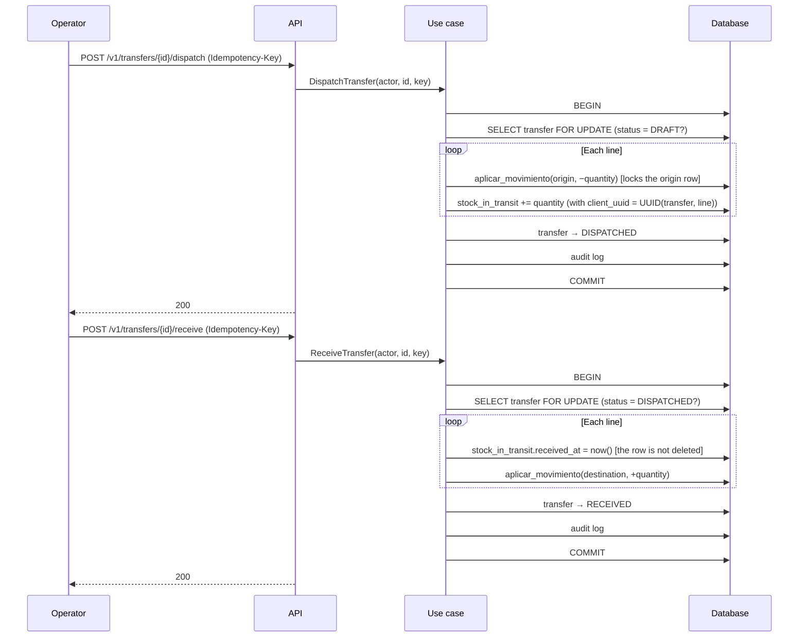

# Transfers: between locations and between warehouses
> **Normative.** Last revised: 2026-10-09. Origin rules: [ADR-0007](../adr/0007-multi-bodega-desde-el-esquema.md). Module: [M05](../modulos/M05-traslados/README.md). **The legacy has no transfer between warehouses**: only location movements. See [analysis](../analisis/legacy-entradas-salidas-ajustes-traslados.md) §1.

## 1. Objective and actors

Move stock from one location to another, or from one warehouse to another. Goods on the way are
counted as **transit** until they arrive, so that the total neither drops nor rises while they are moving.

| Actor | What it does |
|---|---|
| Operator (app or web) | Creates the transfer, dispatches it, receives it |
| Supervisor (web) | Cancels transfers; queries goods in transit |

## 2. Preconditions

- Origin and destination are active locations. If they are in different warehouses, they are different warehouses.
- There is stock available at the origin for each line.

## 3. States

```mermaid
stateDiagram-v2
    [*] --> DRAFT
    DRAFT --> DISPATCHED: dispatch (leaves the origin)
    DISPATCHED --> RECEIVED: receive (enters the destination)
    DRAFT --> CANCELLED
    DISPATCHED --> CANCELLED: only if nobody received it; returns to the origin
    RECEIVED --> [*]
    CANCELLED --> [*]
```

## 4. Flow: dispatch and receive

Dispatching **moves the goods from the origin to transit**. Receiving **moves them from transit to the destination**.
At no moment does goods exist that is not counted.

**Why `FOR UPDATE` on the transfer.** Two simultaneous "receive" calls on the same transfer
would move the goods twice. The lock makes the second one see `RECEIVED` and answer 409. The
same reason applies to dispatching. It is the same pattern as the confirmation of an order (Q8).

**Why the transit is not deleted on receiving.** The row keeps `received_at`. The product total
adds up only the **unreceived** transit; without that condition, the received goods would count twice
(they are already in the destination and in the historical transit). It is the reason for the `WHERE received_at IS NULL` in the total recalculation.

## 5. Cancellation

- Cancelling a transfer in `DRAFT` moves nothing.
- Cancelling a `DISPATCHED` transfer returns the goods to the origin with a compensating movement and
  marks the transit as cancelled. Nothing is deleted (Q6).
- A `RECEIVED` transfer is not cancelled: to undo it, a new transfer in the opposite direction is made.

## 6. Acceptance tests

**T1. Dispatching takes from the origin and puts it in transit, without changing the total**
- Given an origin with 50 and a transfer of 20 in `DRAFT`.
- When it is dispatched.
- Then the origin has 30, the transit 20 and the total remains at 50.

**T2. Receiving puts it in the destination without changing the total**
- Given the transfer from the previous case in `DISPATCHED`.
- When it is received.
- Then the destination has 20, the transit does not add up (`received_at` reported) and the total remains at 50.

**T3. Receiving twice does not move the goods twice**
- Given a `DISPATCHED` transfer.
- When it is received twice in parallel.
- Then the destination receives 20 only once; the second response is 409.

**T4. The origin and the destination in the same warehouse are not a transfer between warehouses**
- Given a transfer between warehouses with origin and destination in the same warehouse.
- When it is created.
- Then it answers `SAME_WAREHOUSE_TRANSFER` (422) and nothing is written.

**T5. Without stock at the origin, it is not dispatched**
- Given an origin with 10 and a transfer of 20.
- When it is dispatched.
- Then it answers `INSUFFICIENT_STOCK` with `available = 10`, and the transfer remains in `DRAFT`.

**T6. Cancelling a dispatched transfer returns the goods**
- Given a `DISPATCHED` transfer of 20.
- When it is cancelled.
- Then the origin recovers 20, the transit is cancelled, the total does not change and the audit log records the cancellation.

**T7. A received transfer is not cancelled**
- Given a `RECEIVED` transfer.
- When cancellation is attempted.
- Then it answers `INVALID_TRANSITION` and nothing changes.

**T8. Transit is seen with its own permission**
- Given a user with `transfer.view` and without `transit.view`.
- When they query goods in transit.
- Then it answers 403.

## 7. Errors

| Code | HTTP | When |
|---|---|---|
| `TRANSFER_NOT_FOUND` | 404 | The transfer does not exist |
| `SAME_LOCATION` | 422 | Origin and destination are the same location |
| `SAME_WAREHOUSE_TRANSFER` | 422 | Transfer between warehouses with the same warehouse |
| `INSUFFICIENT_STOCK` | 409 | No balance at the origin when dispatching |
| `INVALID_TRANSITION` | 409 | Action not allowed in the current state |

## 8. Permissions

| Action | Permission |
|---|---|
| View transfers | `transfer.view` |
| Create | `transfer.create` |
| Dispatch | `transfer.dispatch` |
| Receive | `transfer.receive` |
| Cancel | `transfer.cancel` |
| View transit | `transit.view` (different from `transfer.view`) |

## 9. Audit log

Creating, dispatching, receiving and cancelling write to `audit_log`, with origin, destination and quantities.

## 10. Rules and decisions

- A transfer between warehouses is an outflow movement and an inflow movement that go through the transit:
  [ADR-0007](../adr/0007-multi-bodega-desde-el-esquema.md).
- The stock and its projection: [existencias-y-ajustes.md](existencias-y-ajustes.md).
