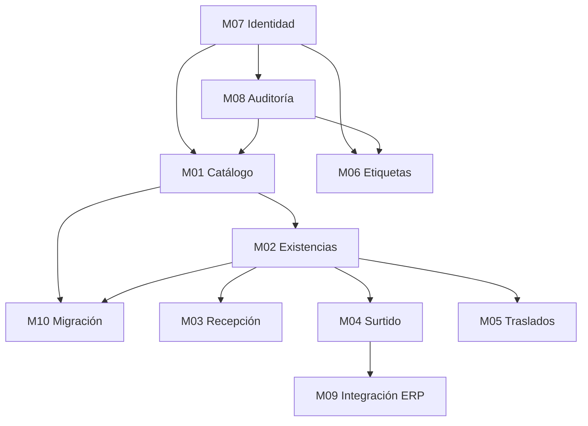

# Plan de implementación: fases, módulos y orden de construcción
> **Plan.** Cómo se construye StockFlow, módulo por módulo, en qué orden y con qué criterio de terminado. Complementa a [PLAN-REHACER.md](PLAN-REHACER.md) (fases y requisitos) y no lo contradice: aquí se baja a módulos. Última revisión: 2026-10-10 (fase 5 en curso).

## 1. Estado al 10 de octubre de 2026

| Fase | Estado | Evidencia |
|---|---|---|
| 0. Decisiones | **Cerrada.** D1–D8 tomadas; versiones verificadas en Maven Central | [stack.md](../arquitectura/stack.md) |
| 1. Infraestructura | **Cerrada** | Compose `stockflow`; `V1`–`V12` aplicadas; rol de la API sin DDL (`ApiRolePrivilegesTest`) |
| 2. API base | **Cerrada** | Seis módulos; `GET /v1/health`; contrato de error; bitácora en la transacción (U1, U3); `ArchitectureTest` |
| 3. Identidad | **Cerrada** | `AuthFlowTest`: login, bloqueo, refresh con reuso, logout y cambio de contraseña, por HTTP real. I5 e I8 se cerraron con la fase 4 |
| 4. Catálogo | **Cerrada salvo el Excel** | `CatalogFlowTest` K1–K6, I5 e I8; `CatalogPersistenceTest`; `RoutePermissionTest` |
| 5. Existencias | **Cerrada** | `InventoryFlowTest` A1–A10 y `ReportFlowTest`; `InventoryEngineConcurrencyTest`; `InventoryWriteGuardTest`; presupuesto de consultas medido |
| 6. Recepción | **En curso**: facturas, captura, aprobación, rechazo, cierre y bandeja cerradas; **falta el enganche de ubicar con la línea** (R1) | `ReceivingFlowTest` R2–R6 y R8 |
| 11. Web | **Empezada** con el catálogo y la identidad, que son los módulos con contrato estable | `web/`: `tsc`, `eslint` y `vite build` en verde; 11 pruebas de Playwright |
| 7–10 | No iniciadas | — |

**622 pruebas, 0 fallos, 0 omitidas** (407 dominio, 11 aplicación, 72 persistencia, 13 web,
11 criptografía, 108 flujo).

Lo que la fase 4 **no** entrega, y por qué:

| Pendiente | Dónde se cierra | Por qué no bloquea |
|---|---|---|
| Lectura de XLSX en la importación | M10 (migración de datos) | El archivo trabajado del corte es un TSV; la ruta responde `IMPORT_FILE_FORMAT` diciéndolo |
| Ubicar no conoce la línea de factura | Fase 6, siguiente paso | `LOCATED` y `locatedQuantity` no se alcanzan por ninguna ruta; la regla B1 solo se aplica en el dominio |
| Pantallas de los módulos sin endpoint | Fases 6–9 | Una pantalla sin endpoint no dibuja filas inventadas: el inicio dice qué falta y por qué |
| Despliegue de la web (nginx + servicio en Compose) | Cierre de la fase 11 | Hoy corre con `pnpm dev` contra la API; el proxy de Vite hace el mismo trabajo que hará nginx |
| `stock` inicial a `SIN-UBICAR` con el movimiento `INITIAL` | Fase 5 (M02) | El informe ya publica `stockPersisted: false`: cargar 10.914.130 unidades sin desglose inventaría mal desde el día uno (ADR-0012) |

I5 (un endpoint sin permiso declarado no arranca) e I8 (una cuenta con el cambio de contraseña
pendiente no usa otras rutas) se cerraron en la fase 4: `RoutePermissionAudit` comprueba la
declaración de cada ruta al arrancar y `CatalogFlowTest` ejercita las dos.

### Lo que la fase 1 dejaba abierto

| # | Pendiente | Resolución |
|---|---|---|
| P1 | Separar el rol de migración del de la API | **Hecho** en `V11`: rol de grupo `stock_api`, sin DDL ni mutación del kardex o la bitácora |
| P2 | Particiones de la bitácora | **Hecho**: `db/callbacks/afterMigrate.sql` asegura 19 meses en cada despliegue. V2 ya tenía una partición por defecto, así que el riesgo era menor del anotado |
| P3 | Versión de Flyway | **Hecho**: `12.4.0`, la que gestiona el BOM de Spring Boot 4.1.1 |
| P4 | Contenedor `stock-adminer` del sistema anterior | **Sin tocar.** Es tuyo. El proyecto nuevo se llama `stockflow` y no choca con él |
| P5 | Ruta de las migraciones | **Hecho**: `db/migrations/`, documentado en [infraestructura.md](../arquitectura/infraestructura.md) §4 |

### Hallazgos que salieron al construir

| Hallazgo | Qué se hizo |
|---|---|
| La bitácora buscaba el eslabón anterior de la cadena recorriendo todas las filas en cada escritura, bajo un cerrojo global | Índice en `V11`. Medido: de 20.000 filas leídas a 1 |
| `audit_log` exigía la traza de acceso en un registro `CRITICAL`, pero la función de escritura no tenía parámetro para recibirla | `V12` |
| El diseño anterior llevaba roles y permisos dentro del token (4.653 caracteres) y no los releía | El token solo identifica (325 caracteres); los permisos se leen en cada petición |
| El bloqueo por intentos solo afectaba a cuentas reales, así que delataba cuáles existían | El bloqueo va por nombre de usuario, exista o no |
| La función del motor promete un mensaje de «stock insuficiente» que nunca se ejecuta: el `CHECK` de la tabla salta antes | Anotado para la fase 5: el caso de uso lee el saldo bloqueado y devuelve el error con `available` |
| Mi Compose se llamaba igual que el del sistema anterior y recreó su contenedor de PostgreSQL | Restaurado sobre su volumen, con los datos intactos. El proyecto pasó a llamarse `stockflow` |
| El catálogo autorizaba dentro del caso de uso, así que una ruta nueva sin autorización funcionaba y nadie se enteraba | `@RequiresPermission` en cada ruta y `RoutePermissionAudit` al arrancar: una ruta sin declarar **impide el arranque** (I5) |
| El fixture de pruebas no restauraba la bodega predeterminada, así que una prueba que la movía rompía la limpieza de la siguiente | `TestDatabase.reset()` restaura la semilla: una prueba no puede romper a la siguiente |
| El conteo de un listado podía ignorar los filtros y decir «1.398» con cero resultados | El conteo y la página comparten filtros; `CatalogPersistenceTest` lo comprueba |

## 2. Módulos

Los módulos de negocio son M01–M09 ([docs/modulos/](../modulos/README.md)). Dos piezas transversales
no son módulos de negocio, pero bloquean a todos: **identidad y permisos** (M07, que es una puerta)
y **auditoría** (M08, que cada escritura usa). Se agrega **M10, migración de datos**, porque el corte
desde el legacy tiene pasos propios ([migracion/cutover.md](../migracion/cutover.md)).

| Módulo | Qué entrega | Flujo que cumple | Depende de | Fase |
|---|---|---|---|---|
| **M07 Identidad y accesos** | Login, refresh, logout, cambio de contraseña, RBAC+ABAC | [autenticacion-y-permisos.md](../flujos/autenticacion-y-permisos.md) | — | 3 |
| **M08 Auditoría** | Bitácora inmutable, registro dentro de la transacción, consulta | [auditoria.md](../flujos/auditoria.md) | M07 | 2 (escritura), 9 (consulta completa) |
| **M01 Catálogo** | Productos, ubicaciones, bodegas, importación estricta | [catalogo.md](../flujos/catalogo.md) | M07, M08 | 4 |
| **M02 Existencias** | Motor de inventario, kardex, ajustes, ubicar, mover, reportes de conciliación | [existencias-y-ajustes.md](../flujos/existencias-y-ajustes.md) | M01 | 5 |
| **M03 Recepción** | Facturas, captura, discrepancias, aprobación, ubicación | [recepcion.md](../flujos/recepcion.md) | M02 | 6 |
| **M04 Surtido** | Órdenes, empaque, faltantes, confirmación | [surtido-y-erp.md](../flujos/surtido-y-erp.md) §1–§4, §6, §8 | M02 | 7 |
| **M09 Integración externa** | Exportación al ERP con reintentos (puerto sin cliente real) | [surtido-y-erp.md](../flujos/surtido-y-erp.md) §5 | M04 | 7 |
| **M05 Traslados** | Traslado entre ubicaciones y entre bodegas, tránsito | [traslados.md](../flujos/traslados.md) | M02 | 8 |
| **M06 Etiquetas** | Plantillas, cola, confirmación con clave de servicio, reimpresión | [etiquetas.md](../flujos/etiquetas.md) | M07, M08 | 9 |
| **M10 Migración de datos** | Importación del Excel, conciliación del stock heredado, corte | [migracion/](../migracion/cutover.md), [ADR-0012](../adr/0012-conciliar-stock-heredado-con-conteo.md) | M01, M02 | 4 y cierre |

Los reportes de existencias y de conciliación son parte de M02, no un módulo aparte.

### 2.1 Grafo de dependencias

Un módulo no empieza hasta que sus dependencias están **terminadas** según §4, no solo codificadas.

## 3. Fases

Cada fase lista sus módulos, lo que entrega cada parte (API, app, web) y el criterio de salida. Las
fases siguen la numeración de [PLAN-REHACER.md](PLAN-REHACER.md) §5.

| Fase | Módulos | API | App | Web | Criterio de salida |
|---|---|---|---|---|---|
| **0. Decisiones** | — | Versiones fijadas (D8) | — | — | D1–D8 tomadas; stack con fuente y fecha |
| **1. Infraestructura** | — | — | — | — | `docker compose up` migra la base; `flyway_schema_history` completo; pendientes P1–P5 resueltos |
| **2. API base** | M08 (escritura) | Proyecto multimódulo, arranque, `GET /v1/health`, manejo de errores, cableado DI, ArchUnit, Testcontainers | — | — | Arranque falla sin variables obligatorias; ArchUnit en verde; M08 escribe en la misma transacción (prueba U1) |
| **3. Identidad** | M07 | Login, refresh con rotación, logout, cambio de contraseña, bloqueo, decisión RBAC+ABAC | Login y sesión (esqueleto) | Login y cambio de contraseña | Pruebas I1–I8 en verde |
| **4. Catálogo** | M01, M10 (importación) | Productos, ubicaciones, bodegas, importación estricta e idempotente | — | Pantalla de productos y ubicaciones | Pruebas K1–K6 en verde; importación del Excel dry-run sin errores |
| **5. Existencias** | M02 | Motor, kardex, ajustes, ubicar, mover, reportes de conciliación. Q1, Q6–Q10 | Consulta de existencias | Existencias, kardex, ajustes | Pruebas A1–A10 en verde, incluida la concurrencia A4; presupuesto de consultas fijado con medición |
| **6. Recepción** | M03 | Facturas, captura, discrepancias, aprobación, ubicación | Captura y ubicar (piso) | Facturas y aprobación | Pruebas R1–R8 en verde |
| **7. Surtido y ERP** | M04, M09 | Órdenes, empaque, faltantes, confirmación, exportación. Q2, Q3 | Empaque | Órdenes y exportación | Pruebas S1–S9 en verde |
| **8. Traslados** | M05 | Entre ubicaciones y bodegas, tránsito | Traslados | Traslados y tránsito | Pruebas T1–T8 en verde, incluida la recepción (hoy sin cobertura) |
| **9. Etiquetas y auditoría** | M06, M08 (consulta) | Plantillas, cola, confirmación con clave de servicio, bitácora consultable | Escaneo de etiquetas | Plantillas, historial, auditoría | Pruebas L1–L5 y U1–U5 en verde |
| **10. App KMP** | — | Contrato estable | Núcleo compartido y pantallas de piso | — | Compila en Android e iOS; recepción probada en dispositivo |
| **11. Web React** | — | Contrato estable | — | Navegación completa; sidebar verificado | Pruebas de navegador de los flujos principales; prueba visual de `index.css` (ver [web-react.md](../arquitectura/web-react.md) §5) |
| **Cierre: corte** | M10 | — | — | — | Conciliación de stock heredado cuadrada o con ajustes motivados ([ADR-0012](../adr/0012-conciliar-stock-heredado-con-conteo.md)) |

**Por qué este orden.** La identidad va primero porque toda operación necesita un actor. El catálogo
va antes que el inventario porque el motor necesita productos y ubicaciones. Recepción, surtido y
traslados van después del motor porque los tres lo llaman y no lo reimplementan. La app y la web van al
final: consumen un contrato que tiene que estar estable, y construirlas antes obliga a rehacer pantallas
cuando la API cambia.

**Lo que puede ir en paralelo** una vez cerrada la fase 5: recepción (6), surtido (7) y traslados (8) son
independientes entre sí. Las pantallas de la app y la web de cada módulo pueden empezar cuando la API
del módulo tiene sus pruebas en verde.

## 4. Definición de terminado por módulo

Un módulo está **terminado** cuando cumple todo lo siguiente. No hay estados intermedios que se
cuenten como avance.

1. **Pruebas de aceptación del flujo en verde.** Cada escenario del documento de flujo tiene una prueba
   automatizada. Un escenario sin prueba no cuenta.
2. **Pruebas de concurrencia** en las operaciones que escriben inventario o estado compartido (Q1, Q3,
   T3, S3, L2).
3. **Presupuesto de consultas** medido en cada listado del módulo (R-P1 de
   [api-spring.md](../arquitectura/api-spring.md) §11).
4. **Permisos en el catálogo.** Cada endpoint tiene su permiso; el arranque falla si falta (I5).
5. **Bitácora.** Cada escritura del módulo tiene su registro, en la misma transacción (U1).
6. **Contrato HTTP** publicado en OpenAPI y en [docs/api/](../api/convenciones.md), coherente con el código.
7. **Errores** con los códigos del documento de flujo, sin códigos nuevos sin añadirlos antes a
   `api/errores.md`.
8. **Documento de flujo sin pendientes abiertos**, o con cada pendiente registrado como decisión.

El criterio 3 no tiene cifras fijadas: el presupuesto se fija con la primera medición del módulo.
Un número inventado no sirve de criterio.

## 5. Orden de trabajo dentro de un módulo

Todo módulo sigue el mismo orden en la API. Así el dominio y la aplicación se prueban antes de que
exista el HTTP:

1. **Dominio** (`domain`): entidades, estados y errores tipados, con pruebas sin base de datos.
2. **Aplicación** (`application`): casos de uso con puertos y fakes; pruebas de cada escenario del flujo.
3. **Persistencia** (`adapters-persistence`): funciones SQL y repositorios; pruebas con PostgreSQL real
   (Testcontainers), incluida la concurrencia.
4. **Web** (`adapters-web`): controladores y contrato HTTP; pruebas de errores y de permisos.
5. **Flujo completo** (`app`): los escenarios de punta a punta.
6. **Cliente** (app y web), solo si el contrato del módulo ya está en verde.

## 6. Riesgos del plan

| Riesgo | Señal temprana | Respuesta |
|---|---|---|
| El motor de inventario tarda más de lo previsto | Fase 5 pasa de su primera semana sin pruebas A1–A4 en verde | Se reduce el alcance del módulo a A1–A4 y se difieren reportes; no se salta la concurrencia |
| Dos rutas de escritura al inventario por fuera del motor | Un revisor encuentra un `UPDATE` sobre `stock_by_location` en `adapters-*` | ArchUnit lo bloquea; se corrige antes de la fase siguiente |
| El ERP real llega tarde | Pendiente D10 sin respuesta | Se mantiene `FAILED` con motivo (ADR-0013); no se bloquea el surtido |
| Las particiones de auditoría caducan | Job P2 sin desplegar antes de febrero de 2027 | Está como pendiente de fase 1 con fecha |
| La web se construye antes que el contrato | Pantallas que cambian cada semana | La web empezó con catálogo e identidad, que tienen contrato probado; las demás pantallas esperan a su endpoint |

## 7. Lo que sigue inmediatamente

1. **Fase 6, recepción (M03), lo que queda:** el **enganche de la ubicación con la línea de factura**.
   `POST /v1/inventory/locate` gana un `invoiceLineId` opcional; con él, el caso de uso carga la línea,
   aplica la regla del dominio (`InvoiceLine.locate`: una discrepancia sin aprobar bloquea, R1) y, al
   terminar, actualiza `located_quantity`, `location_id` y el estado `LOCATED` de la línea —que hoy no
   se alcanza por ninguna ruta—. El resto del módulo está cerrado y probado.
2. **M10, migración:** falta el stock inicial del legacy a `SIN-UBICAR` con el movimiento `INITIAL`
   —que el motor ya soporta—, la lectura de XLSX (Apache POI ya está en el proyecto por la
   exportación del kardex) y la conciliación con conteo.
3. **Fase 11, web:** cada módulo estrena pantalla cuando su contrato está estable. Ya están entrada,
   productos, ubicaciones y bodegas; falta el despliegue (nginx y su servicio en Compose).
