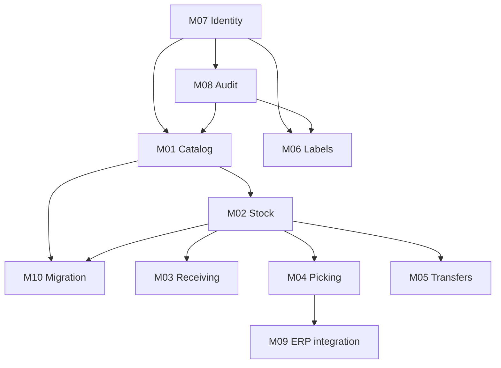

# Implementation plan: phases, modules and build order
> **Plan.** How StockFlow is built, module by module, in which order and with which definition of done. It complements [PLAN-REHACER.md](PLAN-REHACER.md) (phases and requirements) and does not contradict it: here it is broken down to modules. Last revised: 2026-10-10 (phase 5 in progress).

## 1. Status as of October 10, 2026

| Phase | Status | Evidence |
|---|---|---|
| 0. Decisions | **Closed.** D1–D8 taken; versions verified in Maven Central | [stack.md](../arquitectura/stack.md) |
| 1. Infrastructure | **Closed** | Compose `stockflow`; `V1`–`V15` applied; API role without DDL (`ApiRolePrivilegesTest`) |
| 2. Base API | **Closed** | Six modules; `GET /v1/health`; error contract; audit log in the transaction (U1, U3); `ArchitectureTest` |
| 3. Identity | **Closed** | `AuthFlowTest`: sign-in, lock, refresh with reuse, sign-out and password change, over real HTTP. I5 and I8 were closed with phase 4 |
| 4. Catalog | **Closed except the Excel** | `CatalogFlowTest` K1–K6, I5 and I8; `CatalogPersistenceTest`; `RoutePermissionTest` |
| 5. Stock | **Closed** | `InventoryFlowTest` A1–A10 and `ReportFlowTest`; `InventoryEngineConcurrencyTest`; `InventoryWriteGuardTest`; query budget measured |
| 6. Receiving | **Closed** | `ReceivingFlowTest` R1–R8 |
| 11. Web | **Entry, catalog, the seven read modules and the writes of receiving, transfers, picking and reprint**, with the `web` service in Compose | `web/`: `tsc`, `eslint` green; 30 Playwright tests. Pending: create order and locate from the web |
| 7. Picking and ERP | **Closed** | `FulfillmentFlowTest` S1–S8; simultaneous confirmation in `FulfillmentPersistenceTest` |
| 8. Transfers | **Closed** | `TransferEngineTest` (engine and invariant) and `TransferFlowTest` T1–T8 |
| 9. Labels and audit | **Closed**: M06 with L1–L5 and M08 with U1–U5 green | `LabelFlowTest`, `PrintJobConfirmationTest` and `AuditFlowTest` |
| 10. Migration | **Closed in what is code**: strict and idempotent import, which accepts **CSV, TSV and XLSX** and loads the initial stock to `SIN-UBICAR`. What remains belongs to the business (the physical count and the cutover) | `CatalogFlowTest` M10 and `CatalogUploadTest` |

**752 tests, 0 failures, 0 skipped** (412 domain, 11 application, 91 persistence, 17 web,
11 cryptography, 210 flow), measured with `./gradlew verify` on 2026-10-10. Schema at
**V15**.

**Audit of the §4 bar, closed on 2026-10-10.** Module by module, with mechanical checking
where possible:

| Criterion | How it stands |
|---|---|
| Flow acceptance tests | The 68 of the eight flows are automated or covered where the document says (I6/I7 in the access engine, Q2/Q3 as the basis of S2/S3/S5, S9 in the domain because M04 does not define a cancellation route). Checked by cross-referencing them against the tests |
| Concurrency where inventory is written | The stock engine, the picking confirmation claim, the transfer engine and **the receiving capture**, which needed it and did not have it |
| Query budget | Measured in the nine modules: catalog, stock, reports, picking, sessions, users and roles, receiving, transfers and labels |
| Permissions per route | Every route declares its own (a single declaration) and the engine checks it; an architecture test prevents otherwise |
| Audit log in every write | The record of auditable critical use cases is tied to the permission catalog, and each flow checks its entry |
| Contract and errors | **76 documented routes and 76 implemented**, and each page with its codes |

> `./gradlew test` **does not run the domain tests**: the project is
> multiplatform and its task is called `jvmTest`, so the aggregate `test` left it
> out and the report looked green reading XML from a previous run. To verify
> one must use **`./gradlew verify`**, which includes them all.

What phase 4 **does not** deliver, and why:

| Pending | Where it is closed | Why it does not block |
|---|---|---|
| XLSX reading in the import | M10 (data migration) | The working file of the cutover is a TSV; the route answers `IMPORT_FILE_FORMAT` saying so |
| The intermittent `403` when assigning roles | Phase 9, investigated | It stopped reproducing when the wiring of the password policy was fixed, which left the context half done; with the route enabled it passed **five consecutive runs** of the module. The **empty body of the original `403` was left unexplained**: it is noted, not made up. If it reappears, first check the seeding of `role_permissions` at startup |
| Deleting roles | M07, decided | A role is not deleted: it is **deactivated** (`active: false`), and that removes the permissions from whoever has it. Deleting it would leave users without a role and without explanation |
| No route assigns order lines | Phase 7, next step | `order.assign` is in the catalog and the table has `assigned_user_id` and `location_id`, but no route writes them: the location is noted by packing |
| There is no ERP | Phase 7, noted | The attempt fails with `ERP_NOT_CONNECTED` and the counter goes up; the adapter is missing (ADR-0013) |
| **Two simultaneous captures duplicated the stock** | Phase 6, **corrected on 2026-10-10** | The entry is written by the **difference** against what was already received, so two captures of the same line that read the same balance both received the same difference. Now the capture is **claimed** with a conditional statement on `received_quantity` before moving: the first wins, the second answers `409 LINE_CHANGED` and writes nothing. Proven with two real transactions (`ReceivingConcurrencyTest`) |
| **The contract table did not list 12 routes that exist** | §4 bar, **corrected on 2026-10-10** | Among them, **eight that I built myself** in M07 (creation, detail, edit, password reset and the four role ones). They were documented on their page, but the contract index is what is read to know what exists. Now **the 76 documented routes are the 76 implemented**, checked mechanically: none more and none fewer |
| **The query budget of three modules was missing** | §4 bar, **corrected on 2026-10-10** | Receiving, transfers and labels had their flows green and their engine tested, but **nobody had measured** how many statements their reads cost. Now it is measured and tied: a listing is two statements (count and page) and the detail of an invoice or a transfer is two, with its lines. What is not measured is lost at the first well-meant change |
| **The record of auditable use cases was not tied to the catalog** | §4 bar, **corrected on 2026-10-10** | `CriticalUseCases.all` checked that each declaration has a non-empty permission, but **not that this permission exists** in `PermissionCatalog`: a badly written permission would have passed the tests and failed at runtime, inside the transaction of the legitimate operation being audited. Now there is a test that ties it, and another that requires that no use case or action is declared twice |
| **Two report tests failed one hour a day** | Phase 9, **corrected on 2026-10-10** | They asked for `from=today&to=today` with `LocalDate.now()` —the machine's date— while the API dates the movements in `stock.business-zone`. From 23:00 to 00:00 on the west coast, the machine and the business zone are on different days and the summary came out empty. Now the tests use `businessToday()`, which reads the zone from the same configuration as the API |
| **Approving an adjustment did not check the permission** | Phase 5, **corrected on 2026-10-10** | `inventory.approve_adjustment` was in the catalog, granted to roles, documented and audited, but **no code required it**: it was approved by sending another person's `approverId`, and anyone with the permission for the reason could sign their own theft. Now the server loads the approver and requires the permission with the warehouse's scope (`403 APPROVER_NOT_AUTHORIZED`), with two tests: one that rejects it and another that confirms that with an authorized approver the adjustment is applied |
| **24 catalog permissions with no route requiring them** | Audit of 2026-10-10 | Some of them belong to modules that do not exist (cost, financial, devices, `system.config`, `integration.manage`), others are decisions already taken —`user.delete` (it is deactivated), `invoice.edit/delete` and `order.edit/delete` (documents are not deleted), `kardex.export` (covered by `report.export`)—, and three are **documented capabilities with no route**: `invoice.assign`, `order.assign` and `session.revoke`. **`order.assign` already has a route** (`PUT /v1/orders/{id}/lines/{lineId}/assign`, 2026-10-10). **Two** remain: `invoice.assign` —assign an invoice line to a capturer; the `ASSIGNED` state and the domain method exist, the route is missing— and ~~`session.revoke`~~ — **closed on 2026-10-10** with `POST /v1/users/{id}/revoke-sessions`, and with the nuance written: it cuts the **renewal**, not the live access token, and the 30 s grace window of an already rotated token still applies—. **`invoice.assign` too** (`PUT /v1/invoices/{id}/lines/{lineId}/assign`, 2026-10-10). **No documented capability of the catalog is left without a route**: the 24 unused ones belong to modules that do not exist (cost, financial, devices, `system.config`, `integration.manage`) or to decisions already taken (documents are not deleted, a user is deactivated) |
| ~~No route emits `RECEIPT_IN`~~ | Phase 6, **closed on 2026-10-10** | The goods enter **when counted**, with a `RECEIPT_IN` for the **difference** against what the line has already received (`invoice_lines.received_quantity`, V15). A recount does not add twice, and if what was counted is less, the difference leaves with an adjustment for a count error. Three tests: the entry when counted, the downward recount and the upward recount. The locate tests no longer seed the balance by hand |
| Screens of the modules without an endpoint | Phases 6–9 | A screen without an endpoint does not draw invented rows: the home page says what is missing and why |
| ~~Deployment of the web (nginx + service in Compose)~~ | Phase 11, **closed on 2026-10-10** | `web` service in Compose (`127.0.0.1:8085`): unprivileged nginx that serves the SPA and forwards `/v1/` to the API over the internal network. The security headers are repeated per block because `add_header` of a `location` overrides those of the `server` |
| Initial `stock` to `SIN-UBICAR` with the `INITIAL` movement | Phase 5 (M02) | The report already publishes `stockPersisted: false`: loading 10,914,130 units without a breakdown would misstate the inventory from day one (ADR-0012) |

I5 (an endpoint with no declared permission does not start) and I8 (an account with a pending
password change does not use other routes) were closed in phase 4: `RoutePermissionAudit` checks the
declaration of each route at startup and `CatalogFlowTest` exercises both.

### What phase 1 left open

| # | Pending | Resolution |
|---|---|---|
| P1 | Separate the migration role from the API's | **Done** in `V11`: group role `stock_api`, without DDL nor mutation of the ledger or the audit log |
| P2 | Audit log partitions | **Done**: `db/callbacks/afterMigrate.sql` ensures 19 months on each deployment. V2 already had a default partition, so the risk was smaller than noted |
| P3 | Flyway version | **Done**: `12.4.0`, the one managed by the Spring Boot 4.1.1 BOM |
| P4 | `stock-adminer` container of the previous system | **Not touched.** It is yours. The new project is called `stockflow` and does not clash with it |
| P5 | Path of the migrations | **Done**: `db/migrations/`, documented in [infraestructura.md](../arquitectura/infraestructura.md) §4 |

### Findings that came out while building

| Finding | What was done |
|---|---|
| The audit log looked for the previous link of the chain by scanning all the rows on each write, under a global lock | Index in `V11`. Measured: from 20,000 rows read to 1 |
| `audit_log` required the access trace in a `CRITICAL` record, but the write function had no parameter to receive it | `V12` |
| The previous design carried roles and permissions inside the token (4,653 characters) and did not re-read them | The token only identifies (325 characters); the permissions are read on each request |
| The attempt lock only affected real accounts, so it gave away which ones existed | The lock goes by user name, whether or not it exists |
| The engine function promises an "insufficient stock" message that never runs: the table's `CHECK` fires first | Noted for phase 5: the use case reads the locked balance and returns the error with `available` |
| My Compose had the same name as the previous system's and recreated its PostgreSQL container | Restored over its volume, with the data intact. The project was renamed `stockflow` |
| The catalog authorized inside the use case, so a new route without authorization worked and nobody noticed | `@RequiresPermission` on each route and `RoutePermissionAudit` at startup: an undeclared route **prevents startup** (I5) |
| The test fixture did not restore the default warehouse, so a test that moved it broke the cleanup of the next one | `TestDatabase.reset()` restores the seed: a test cannot break the next one |
| The count of a listing could ignore the filters and say "1,398" with zero results | The count and the page share filters; `CatalogPersistenceTest` checks it |

## 2. Modules

The business modules are M01–M09 ([docs/modulos/](../modulos/README.md)). Two cross-cutting pieces
are not business modules, but they block all of them: **identity and permissions** (M07, which is a gate)
and **audit** (M08, which every write uses). **M10, data migration**, is added, because the cutover
from the legacy has steps of its own ([migracion/cutover.md](../migracion/cutover.md)).

| Module | What it delivers | Flow it fulfills | Depends on | Phase |
|---|---|---|---|---|
| **M07 Identity and access** | Sign-in, refresh, sign-out, password change, RBAC+ABAC | [autenticacion-y-permisos.md](../flujos/autenticacion-y-permisos.md) | — | 3 |
| **M08 Audit** | Immutable log, recording inside the transaction, query | [auditoria.md](../flujos/auditoria.md) | M07 | 2 (writing), 9 (full query) |
| **M01 Catalog** | Products, locations, warehouses, strict import | [catalogo.md](../flujos/catalogo.md) | M07, M08 | 4 |
| **M02 Stock** | Inventory engine, ledger, adjustments, locate, move, reconciliation reports | [existencias-y-ajustes.md](../flujos/existencias-y-ajustes.md) | M01 | 5 |
| **M03 Receiving** | Invoices, capture, discrepancies, approval, location | [recepcion.md](../flujos/recepcion.md) | M02 | 6 |
| **M04 Picking** | Orders, packing, shortages, confirmation | [surtido-y-erp.md](../flujos/surtido-y-erp.md) §1–§4, §6, §8 | M02 | 7 |
| **M09 External integration** | Export to the ERP with retries (port without a real client) | [surtido-y-erp.md](../flujos/surtido-y-erp.md) §5 | M04 | 7 |
| **M05 Transfers** | Transfer between locations and between warehouses, transit | [traslados.md](../flujos/traslados.md) | M02 | 8 |
| **M06 Labels** | Templates, queue, confirmation with service key, reprint | [etiquetas.md](../flujos/etiquetas.md) | M07, M08 | 9 |
| **M10 Data migration** | Excel import, reconciliation of the legacy stock, cutover | [migracion/](../migracion/cutover.md), [ADR-0012](../adr/0012-conciliar-stock-heredado-con-conteo.md) | M01, M02 | 4 and closing |

The stock and reconciliation reports are part of M02, not a separate module.

### 2.1 Dependency graph

A module does not start until its dependencies are **finished** according to §4, not just coded.

## 3. Phases

Each phase lists its modules, what each part delivers (API, app, web) and the exit criterion. The phases
follow the numbering of [PLAN-REHACER.md](PLAN-REHACER.md) §5.

| Phase | Modules | API | App | Web | Exit criterion |
|---|---|---|---|---|---|
| **0. Decisions** | — | Versions pinned (D8) | — | — | D1–D8 taken; stack with source and date |
| **1. Infrastructure** | — | — | — | — | `docker compose up` migrates the database; `flyway_schema_history` complete; pending P1–P5 resolved |
| **2. Base API** | M08 (writing) | Multimodule project, startup, `GET /v1/health`, error handling, DI wiring, ArchUnit, Testcontainers | — | — | Startup fails without required variables; ArchUnit green; M08 writes in the same transaction (test U1) |
| **3. Identity** | M07 | Sign-in, refresh with rotation, sign-out, password change, lock, RBAC+ABAC decision | Sign-in and session (skeleton) | Sign-in and password change | Tests I1–I8 green |
| **4. Catalog** | M01, M10 (import) | Products, locations, warehouses, strict and idempotent import | — | Products and locations screen | Tests K1–K6 green; Excel import dry-run without errors |
| **5. Stock** | M02 | Engine, ledger, adjustments, locate, move, reconciliation reports. Q1, Q6–Q10 | Stock lookup | Stock, ledger, adjustments | Tests A1–A10 green, including concurrency A4; query budget set with measurement |
| **6. Receiving** | M03 | Invoices, capture, discrepancies, approval, location | Capture and locate (floor) | Invoices and approval | Tests R1–R8 green |
| **7. Picking and ERP** | M04, M09 | Orders, packing, shortages, confirmation, export. Q2, Q3 | Packing | Orders and export | Tests S1–S9 green |
| **8. Transfers** | M05 | Between locations and warehouses, transit | Transfers | Transfers and transit | Tests T1–T8 green, including receipt (today without coverage) |
| **9. Labels and audit** | M06, M08 (query) | Templates, queue, confirmation with service key, queryable log | Label scanning | Templates, history, audit | Tests L1–L5 and U1–U5 green |
| **10. KMP app** | — | Stable contract | Shared core and floor screens | — | Compiles on Android and iOS; receiving tested on a device |
| **11. React web** | — | Stable contract | — | Full navigation; sidebar verified | Browser tests of the main flows; visual test of `index.css` (see [web-react.md](../arquitectura/web-react.md) §5) |
| **Closing: cutover** | M10 | — | — | — | Legacy stock reconciliation balanced or with motivated adjustments ([ADR-0012](../adr/0012-conciliar-stock-heredado-con-conteo.md)) |

**Why this order.** Identity goes first because every operation needs an actor. The catalog
goes before the stock because the engine needs products and locations. Receiving, picking and
transfers go after the engine because all three call it and do not reimplement it. The app and the web go
last: they consume a contract that has to be stable, and building them earlier forces redoing screens
when the API changes.

**What can go in parallel** once phase 5 is closed: receiving (6), picking (7) and transfers (8) are
independent of each other. The app and web screens of each module can start when the API of the module has its tests green.

## 4. Definition of done per module

A module is **finished** when it meets all of the following. There are no intermediate states that
count as progress.

1. **Flow acceptance tests green.** Each scenario of the flow document has an automated test.
   A scenario without a test does not count.
2. **Concurrency tests** in the operations that write inventory or shared state (Q1, Q3,
   T3, S3, L2).
3. **Query budget** measured in each listing of the module (R-P1 of
   [api-spring.md](../arquitectura/api-spring.md) §11).
4. **Permissions in the catalog.** Each endpoint has its permission; startup fails if it is missing (I5).
5. **Audit log.** Each write of the module has its record, in the same transaction (U1).
6. **HTTP contract** published in OpenAPI and in [docs/api/](../api/convenciones.md), consistent with the code.
7. **Errors** with the codes of the flow document, with no new codes without adding them first to
   `api/errores.md`.
8. **Flow document without open pending items**, or with each pending item recorded as a decision.

Criterion 3 has no figures set: the budget is set with the module's first measurement.
An invented number is no use as a criterion.

## 5. Work order within a module

Every module follows the same order in the API. That way the domain and the application are tested before
the HTTP exists:

1. **Domain** (`domain`): entities, states and typed errors, with tests without a database.
2. **Application** (`application`): use cases with ports and fakes; tests of each scenario of the flow.
3. **Persistence** (`adapters-persistence`): SQL functions and repositories; tests with real PostgreSQL
   (Testcontainers), including concurrency.
4. **Web** (`adapters-web`): controllers and HTTP contract; error and permission tests.
5. **Complete flow** (`app`): the end-to-end scenarios.
6. **Client** (app and web), only if the module's contract is already green.

## 6. Plan risks

| Risk | Early signal | Response |
|---|---|---|
| The inventory engine takes longer than planned | Phase 5 goes past its first week without tests A1–A4 green | The scope of the module is reduced to A1–A4 and reports are deferred; concurrency is not skipped |
| Two write paths to the inventory outside the engine | A reviewer finds an `UPDATE` on `stock_by_location` in `adapters-*` | ArchUnit blocks it; it is fixed before the next phase |
| The real ERP arrives late | Pending D10 without a response | It stays `FAILED` with a reason (ADR-0013); picking is not blocked |
| The audit partitions expire | Job P2 not deployed before February 2027 | It is pending from phase 1 with a date |
| The web is built before the contract | Screens that change every week | The web started with the catalog and identity, which have a tested contract; the other screens wait for their endpoint |

## 7. What comes immediately next

1. **The rest of M07 (users and roles):** creation and management of users and roles, which the phase 3 flow
   left out. Today there is only the administrator that seeds at startup; the `user.*` and
   `role.*` permissions are in the catalog and **no route uses them**.
2. **What remains of the migration is not code**: the physical count of the 1,398 products, the
   reconciliation against the inherited total and the cutover ([cutover.md](../migracion/cutover.md)). The
   verified database backup still **does not exist in the repo** and is a prerequisite of the cutover.
2. **M10, migration:** the initial legacy stock to `SIN-UBICAR` with the `INITIAL` movement is missing
   —which the engine already supports—, the XLSX reading (Apache POI is already in the project for the
   ledger export) and the reconciliation with a count.
3. **Phase 11, web:** the read screens and the receiving writes (creation, capture,
   approve, reject, close), transfers (dispatch, receive, cancel), picking (assign to myself, pack,
   shortage, confirm, export) and label reprint are done. Pending: create order (it needs its line contract in the web) and locate goods from an invoice from the web (today the floor app does it). Assigning an invoice line to oneself is already there; assigning it to another capturer is not. Each new action goes with its browser test, and only when its endpoint and its errors are in the contract.
